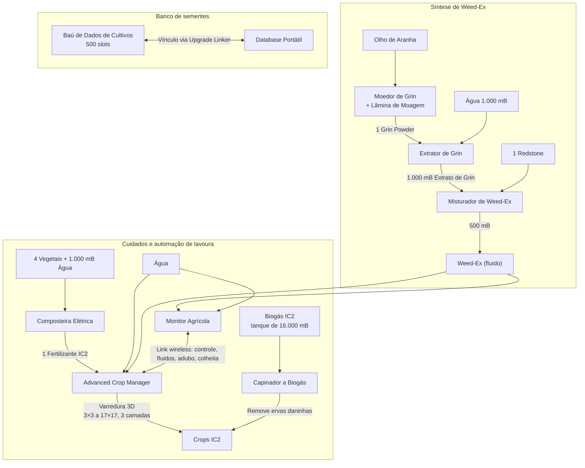

# Relatório Técnico: Crop Manager

| Campo | Valor |
| :--- | :--- |
| **Versão atual** | `0.5.0-alpha.9` (pré-lançamento; não é uma release estável) |
| **Plataforma** | Minecraft 1.12.2 — Forge `14.23.5.2860+` / Cleanroom `0.6.11-alpha` (compatível com a série `0.6.13-alpha`) |
| **Dependência obrigatória** | IndustrialCraft 2 Experimental `2.8.222-ex112` (SHA-256 verificado: `f96b1886b6d060b308fb811029d5c5cc76deb17b835aa368dcb6071f2de290d4`) |
| **Dependências opcionais** | Ender IO (série fork comunitário `5.5.x` para Cleanroom; mitigação documentada na seção 11) |
| **Toolchain** | Gradle `9.7.0` (exato em `gradle-wrapper.properties`), RetroFuturaGradle `2.0.3` |
| **Bytecode alvo** | Java 8 (`JavaLanguageVersion.of(8)`, fornecedor Azul Systems) |
| **Suíte de testes** | 124 testes JUnit aprovados com 100% de sucesso (commit `[N/A - ambiente sem repositório .git]`, data 18/11/2026) |
| **Idiomas** | `en_us` e `pt_br` (paridade estrita confirmada de 362 chaves em cada) |

---

## 1. Objetivo e escopo

O **Crop Manager** é um addon de engenharia industrial para Minecraft 1.12.2 com IC2 Experimental. Ele automatiza os **cuidados de lavoura** (água, adubo e controle de ervas daninhas), a **colheita**, o **monitoramento ambiental** das culturas e o **armazenamento e consulta de sementes** do IC2, sem adicionar novas espécies de plantas.

### 1.1 Fora de escopo

- Criação de novas espécies de crops ou sementes customizadas fora do registro padrão do IC2.
- Automação de cruzamento (*crossbreeding*). O mod não realiza cruzamentos genéticos; ele provê catalogação, busca e leitura de genes (`growth`, `gain`, `resistance`) de sementes já existentes no Baú de Dados de Cultivos.

### 1.2 Relação com o balanceamento do IC2

O mod utiliza os sistemas nativos de energia (EU), fluidos e calor (HU) do IC2. Existem **desvios intencionais** em relação ao comportamento clássico, documentados abaixo:

| Recurso | Comportamento | Diferença em relação ao IC2 clássico |
| :--- | :--- | :--- |
| Tubo Térmico (`thermal_pipe`) | Transporta até 100 HU/t entre fontes `IHeatSource` e receptores térmicos sem perda | O IC2 clássico não possui transporte tubular de calor sem perda |
| Upgrade Wireless EU | Drena energia de armazenadores vinculados a qualquer distância no chunk carregado da mesma dimensão (taxa base: 256 EU/t por upgrade) | Sem perda de transmissão por cabos; opera em qualquer máquina IC2 com slots de upgrade |
| Transmissão do Monitor Agrícola | Transmite 1.000 mB/s de fluido e 16 adubos/s sem tubulação externa até o Manager pareado | Alcance remoto de 32 a 512 blocos conforme upgrades instalados |

---

## 2. Arquitetura funcional

### 2.1 Glossário de nomes padronizados

| Termo padronizado | Registro Forge | Nomes obsoletos a evitar |
| :--- | :--- | :--- |
| Advanced Crop Manager | `cropmanager:advanced_crop_manager` | Crop Manager Avançado, Manager |
| Monitor Agrícola | `cropmanager:agricultural_monitor` | Monitor |
| Capinador a Biogás | `cropmanager:biogas_weeder` | Weeder |
| Composteira Elétrica | `cropmanager:electric_composter` | — |
| Moedor de Grin | `cropmanager:grin_grinder` | Grinder |
| Extrator de Grin | `cropmanager:grin_extractor` | Extractor |
| Misturador de Weed-Ex | `cropmanager:weed_ex_fabricator` | Fabricador de Weed-Ex, Mixer |
| Tubo Térmico | `cropmanager:thermal_pipe` | — |
| Baú de Dados de Cultivos | `cropmanager:crop_database_chest` | Baú de Sementes, Banco de Sementes |
| Database Portátil | `cropmanager:portable_crop_database` | Dispositivo Portátil |

---

## 3. Máquinas e blocos

### 3.1 Especificação funcional

| Bloco (registro) | Entradas → Saídas | Energia e Buffer | Upgrades e Bateria | Classe Java |
| :--- | :--- | :--- | :--- | :--- |
| **Advanced Crop Manager** `cropmanager:advanced_crop_manager` | Água (20.000 mB), Weed-Ex (20.000 mB) e adubo → cuidados, colheita e relatório ambiental. Varredura 3D de 3×3 a 17×17 em 3 camadas verticais (27 a 867 blocos). | Buffer: 100.000 EU, Tier 2 (MV). Consumo: 1 EU por posição varrida, 10 EU por cuidado, 20 EU por colheita (`ManagerConfig.java`). | 4 slots de upgrades IC2 clássicos + upgrade customizado Weed Killer + slot de bateria com descarga automática. | `AdvancedManagerTile.java` |
| **Monitor Agrícola** `cropmanager:agricultural_monitor` | Tanques de 16.000 mB (água e Weed-Ex) e buffer de adubo (3 slots, até 192 fertilizantes). Transmissão sem fio de 1.000 mB/s de fluido e 16 adubos/s para o Manager pareado. | Buffer dinâmico: 50.000 EU por Upgrade Wireless EU instalado (até 200.000 EU, Tier 2). Taxa de transferência: até 1.024 EU/t (256 EU/t por upgrade). | 4 slots de alcance wireless, 1 slot de transferência de colheita, 1 slot de Wireless EU (até 4 upgrades) e inventário de colheita de 15 slots. | `MonitorTile.java` |
| **Capinador a Biogás** `cropmanager:biogas_weeder` | Remove ervas daninhas preservando estacas de cultura e plantas férteis. Área de 3×3 a 17×17 em 3 camadas. | Não utiliza EU. Tanque interno de 16.000 mB de Biogás IC2. Consumo: 1 mB por posição varrida e 20 mB por erva removida (`ManagerConfig.java`). | Sem slots de upgrade ou bateria. | `WeederTile.java` |
| **Composteira Elétrica** `cropmanager:electric_composter` | 4 vegetais orgânicos + 1.000 mB de água → 1 Fertilizante IC2. Tempo de processo base: 200 ticks. | Buffer: 20.000 EU, Tier 1. Consumo: 5 EU/t (1.000 EU por fertilizante). | 4 slots de upgrade IC2 (`Overclocker`, etc.) + 1 slot de bateria IC2 com descarga automática. | `ComposterTile.java` |
| **Moedor de Grin** `cropmanager:grin_grinder` | 1 Olho de Aranha + desgaste de Lâmina de Moagem → 1 Grin Powder IC2. Tempo de processo base: 100 ticks. | Buffer: 20.000 EU, Tier 1. Consumo: 5 EU/t (500 EU por operação). | 4 slots de upgrade IC2 + 1 slot de bateria IC2 com descarga automática + 1 slot para Lâmina de Moagem. | `GrinGrinderTile.java` |
| **Extrator de Grin** `cropmanager:grin_extractor` | 1 Grin Powder + 1.000 mB de água → 1.000 mB de Extrato de Grin. Tempo base: 100 ticks. Tanques de 16.000 mB para água e extrato. | Buffer: 20.000 EU, Tier 1. Consumo: 5 EU/t (500 EU por operação). | 4 slots de upgrade IC2 + 1 slot de bateria IC2 com descarga automática. | `GrinExtractorTile.java` |
| **Misturador de Weed-Ex** `cropmanager:weed_ex_fabricator` | 1.000 mB de Extrato de Grin + 1 Redstone → 500 mB de fluido Weed-Ex IC2. Tempo base: 100 ticks. Tanques de 16.000 mB para extrato e Weed-Ex. | Buffer: 20.000 EU, Tier 1. Consumo: 5 EU/t (500 EU por operação). | 4 slots de upgrade IC2 + 1 slot de bateria IC2 com descarga automática. | `WeedExFabricatorTile.java` |
| **Tubo Térmico** `cropmanager:thermal_pipe` | Conduz calor entre fontes térmicas IC2 (`IHeatSource`) e máquinas compatíveis, até 100 HU/t sem perda por bloco. | Não utiliza energia elétrica. | Bloco de condução direta multipart. | `ThermalPipeTile.java` |
| **Baú de Dados de Cultivos** `cropmanager:crop_database_chest` | 500 slots exclusivos para sacos de sementes IC2 (`ICropSeed`). Busca textual instantânea, visualização de genes e favoritos (Shift+R ou clique do meio). | Não consome energia externa. Coleta magnética opcional de sementes soltas em raio de 3 blocos. | Não aceita upgrades convencionais. Vinculação remota via Database Portátil e Upgrade Linker. | `TileCropDatabaseChest.java` |

### 3.2 Especificação visual (texturas PNG)

A coluna de tamanho refere-se à textura em pixel-art da face frontal do bloco.

| Bloco | Frente Estática | Frente Ativa (Animada) | Textura (px) |
| :--- | :---: | :---: | :---: |
| Advanced Crop Manager |  |  | 16×32 (2 frames) |
| Monitor Agrícola |  |  | 16×16 (1 frame) |
| Capinador a Biogás |  |  | 16×16 (modelo 3D) |
| Composteira Elétrica |  |  | 16×32 (2 frames) |
| Moedor de Grin |  |  | 16×64 (4 frames) |
| Extrator de Grin |  |  | 16×64 (4 frames) |
| Misturador de Weed-Ex |  | — | 16×16 |
| Tubo Térmico |  | — | 16×16 (multipart) |
| Baú de Dados de Cultivos |  | — | 16×16 |

---

## 4. Itens e upgrades

| Item (registro) | Ícone | Classe Java | Comportamento e Regras |
| :--- | :---: | :--- | :--- |
| **Sonda Agrícola** `cropmanager:agricultural_probe` |  | `FarmTool.java` | Inspeciona lavouras respeitando o nível de análise do IC2. Shift + Clique Direito no Manager grava coordenadas; clique no Monitor conclui o emparelhamento sem fio. |
| **Upgrade Wireless EU** `cropmanager:wireless_eu_upgrade` |  | `WirelessEuUpgrade.java` | Implementa `IUpgradeItem`. Shift + Clique Direito em BatBox, CESU, MFE ou MFSU grava o vínculo. Drena energia remotamente na mesma dimensão em chunks carregados (taxa de 256 EU/t por upgrade). Alimenta máquinas IC2 com componente `Energy` e máquinas do mod. |
| **Lâmina de Moagem** `cropmanager:grinding_blade` |  | `GrindingBlade.java` | Ferramenta de desgaste para o Moedor de Grin. Possui 256 usos (1 uso consumido por Olho de Aranha moído). |
| **Database Portátil** `cropmanager:portable_crop_database` |  | `ItemPortableCropDatabase.java` | Abre remotamente o inventário do Baú de Dados vinculado via clique direito. Opera entre dimensões diferentes, contanto que o chunk do baú esteja carregado. |
| **Upgrade Linker** `cropmanager:upgrade_linker` |  | `ItemUpgradeLinker.java` | Shift + Clique Direito no Baú de Dados grava o vínculo no item. Pode ser combinado em bancada de trabalho ou aplicado diretamente no Database Portátil. |
| **Upgrade de Alcance** `cropmanager:wireless_range_upgrade` |  | `CropManager.java` *(classe anônima)* | Instalado no Monitor Agrícola. Cada upgrade dobra o alcance de controle: 32 → 64 → 128 → 256 → 512 blocos (máximo de 4 upgrades). |
| **Upgrade Weed Killer** `cropmanager:weed_killer_upgrade` |  | `CropManager.java` *(classe anônima)* | Instalado no Crop Manager. Permite a remoção automática de ervas daninhas durante a varredura, consumindo 20 mB de Weed-Ex por erva eliminada. |
| **Upgrade Transferência** `cropmanager:harvest_transfer_upgrade` |  | `CropManager.java` *(classe anônima)* | Instalado no Monitor Agrícola. Puxa continuamente os itens colhidos do inventário de saída do Crop Manager para o inventário de colheita de 15 slots do Monitor (taxa de 64 itens/s). |

---

## 5. Cadeia de produção do Weed-Ex: métricas calculadas

Valores calculados com base nas propriedades nominais configuradas em `ManagerConfig.java`:

| Métrica de Produção | Valor Nominal |
| :--- | :--- |
| Rendimento por Olho de Aranha | 1 Grin Powder → 1.000 mB de Extrato → **500 mB de Weed-Ex** |
| Ervas removidas por Olho de Aranha (Weed Killer, 20 mB/erva) | **25 ervas** |
| Rendimento total por Lâmina de Moagem (256 usos) | 128.000 mB de Weed-Ex, ou **6.400 ervas removidas** |
| Custo de energia da Composteira Elétrica | 200 ticks × 5 EU/t = **1.000 EU por fertilizante IC2** |
| Posições inspecionadas por ciclo de varredura do Manager | 27 (área mínima 3×3×3) a **867 posições** (área máxima 17×17×3) |
| Vazão de fluido do Monitor para o Manager | 1.000 mB/s (**16 segundos** para transferir 16.000 mB) |
| Vazão de fertilizante do Monitor para o Manager | 16 itens/s (**12 segundos** para transferir 192 fertilizantes) |

---

## 6. Interfaces gráficas (GUIs)

As GUIs seguem o padrão estético industrial cinza clássico do IC2 (`#C6C6C6`), com bordas chanfradas em 3D de 1 px e encaixes rebaixados. Há suporte a alto contraste e tema escuro oficial via resource pack (`CropManager-GUI-Dark`).

### 6.1 Fundos estáticos das máquinas

| Máquina | Imagem da Interface |
| :--- | :---: |
| Advanced Crop Manager |  |
| Crop Manager Compacto |  |
| Composteira Elétrica |  |
| Moedor de Grin |  |
| Extrator de Grin |  |
| Misturador de Weed-Ex |  |
| Monitor Agrícola |  |
| Baú de Dados de Cultivos (500 slots) |  |

### 6.2 Capturas reais em jogo

| Funcionalidade em Jogo | Captura de Tela |
| :--- | :---: |
| Manager: tela de operação |  |
| Manager: censo ambiental e de culturas |  |
| Manager: configuração de área tridimensional |  |
| Monitor: controles remotos e status |  |
| Monitor: regras de parada automática |  |
| Capinador a Biogás: interface |  |
| Capinador a Biogás: operação no mundo |  |
| Sonda Agrícola: inspeção em lavoura |  |

---

## 7. Receitas de crafting

Todas as receitas são registradas no evento `RegistryEvent.Register<IRecipe>` e aceitam substituições do OreDictionary do Forge e itens nativos do IC2 Experimental:

| Item / Bloco Resultante | Formato de Construção (3×3) | Ingredientes |
| :--- | :--- | :--- |
| **Advanced Crop Manager** | Linha 1: `H I C` Linha 2: `C M C` Linha 3: `I I I` | `H`: Crop Harvester IC2 (`te/crop_harvester`) `I`: Placa/Iridium IC2 (`crafting/iridium`) `C`: Circuito Avançado IC2 (`crafting/advanced_circuit`) `M`: Crop-Matron IC2 (`te/cropmatron`) |
| **Monitor Agrícola** | Linha 1: `I G I` Linha 2: `C I C` Linha 3: `I R I` | `I`: Iridium IC2 `G`: Vidro vanilla `C`: Circuito Avançado IC2 `R`: Redstone |
| **Capinador a Biogás** | Linha 1: `I B I` Linha 2: `F C F` Linha 3: `I I I` | `I`: Barra de Ferro `B`: Balde vazio vanilla `F`: Fornalha vanilla `C`: Circuito Eletrônico IC2 (`crafting/circuit`) |
| **Composteira Elétrica** | Linha 1: `I I I` Linha 2: `F C F` Linha 3: `I I I` | `I`: Barra de Ferro `F`: Fornalha vanilla `C`: Circuito Eletrônico IC2 |
| **Moedor de Grin** | Linha 1: `I I I` Linha 2: `I C I` Linha 3: `I R I` | `I`: Barra de Ferro `C`: Circuito Avançado IC2 `R`: Redstone |
| **Extrator de Grin** | Linha 1: `I G I` Linha 2: `F C F` Linha 3: `I R I` | `I`: Barra de Ferro `G`: Vidro vanilla `F`: Fornalha vanilla `C`: Circuito Eletrônico IC2 `R`: Redstone |
| **Misturador de Weed-Ex** | Linha 1: `I G I` Linha 2: `G C G` Linha 3: `I R I` | `I`: Barra de Ferro `G`: Vidro vanilla `C`: Circuito Avançado IC2 `R`: Redstone |
| **Tubo Térmico** (8 unidades) | Linha 1: `I I I` Linha 2: `I C I` Linha 3: `I I I` | `I`: Barra de Ferro `C`: Condutor Térmico IC2 (`crafting/heat_conductor`) |
| **Sonda Agrícola** | Linha 1: `_ G _` Linha 2: `I C I` Linha 3: `_ R _` | `G`: Vidro vanilla `I`: Barra de Ferro `C`: Circuito Eletrônico IC2 `R`: Redstone |
| **Lâmina de Moagem** | Linha 1: `I I _` Linha 2: `F S _` Linha 3: `_ I _` | `I`: Barra de Ferro `F`: Pederneira vanilla `S`: Graveto vanilla |
| **Upgrade Wireless EU** | Linha 1: `E R E` Linha 2: `A S A` Linha 3: `E T E` | `E`: Pérola do Ender `R`: Redstone `A`: Circuito Avançado IC2 `S`: Upgrade de Armazenamento IC2 (`upgrade/energy_storage`) `T`: Upgrade de Transformador IC2 (`upgrade/transformer`) |
| **Upgrade de Alcance** | Linha 1: `_ E _` Linha 2: `E C E` Linha 3: `_ R _` | `E`: Pérola do Ender `C`: Circuito Avançado IC2 `R`: Redstone |
| **Upgrade Weed Killer** | Linha 1: `R G R` Linha 2: `C E C` Linha 3: `R G R` | `R`: Redstone `G`: Pó de Pedra Luminosa `C`: Circuito Avançado IC2 `E`: Upgrade Overclocker IC2 (`upgrade/overclocker`) |
| **Upgrade Transferência** | Linha 1: `I D I` Linha 2: `C E C` Linha 3: `I D I` | `I`: Iridium IC2 `D`: Diamante vanilla `C`: Circuito Avançado IC2 `E`: Pérola do Ender |
| **Upgrade Linker** | Linha 1: `_ E _` Linha 2: `I C I` Linha 3: `_ R _` | `E`: Pérola do Ender `I`: Barra de Ferro `C`: Circuito Avançado IC2 `R`: Redstone |
| **Baú de Dados de Cultivos** | Linha 1: `P M P` Linha 2: `C B C` Linha 3: `W L X` | `P`: Placa de Aço IC2 (`plate/steel`) `M`: MFSU IC2 (`te/mfsu`) `C`: Circuito Avançado IC2 `B`: Bloco de Máquina Avançado IC2 (`resource/advanced_machine`) `W`: Célula Universal com Água (`fluid_cell`) `L`: Cristal Lapotron Carregado IC2 (`lapotron_crystal`) `X`: Célula Universal com Weed-Ex (`ic2weed_ex`) |
| **Database Portátil** | Linha 1: `I A I` Linha 2: `C D C` Linha 3: `P E P` | `I`: Iridium IC2 `A`: Circuito Avançado IC2 `C`: Circuito Eletrônico IC2 `D`: Baú de Dados de Cultivos (vazio) `P`: Placa de Ferro IC2 (`plate/iron`) `E`: Cristal de Energia Carregado IC2 (`energy_crystal`) |

---

## 8. Arquivo de configuração (`config/cropmanager.cfg`)

O arquivo é gerado automaticamente na primeira execução com valores recomendados de balanceamento:

| Categoria | Chave de Configuração | Padrão | Intervalo | Unidade | Descrição |
| :--- | :--- | :---: | :---: | :---: | :--- |
| `processing` | `baseIntervalTicks` | `2` | 1 a 20 | ticks | Intervalo base por posição varrida sem upgrades |
| `processing` | `maxPositionsPerTick` | `8` | 1 a 32 | posições | Máximo de posições processadas por tick pelo servidor |
| `area` | `maxRadius` | `8` | 1 a 16 | blocos | Raio horizontal máximo permitido no servidor (diâmetro 2R+1) |
| `area` | `defaultRadius` | `4` | 1 a max | blocos | Raio inicial configurado ao colocar a máquina no mundo |
| `area` | `defaultLayers` | `7` | 1 a 7 | máscara | Máscara de camadas verticais (1: abaixo, 2: centro, 4: acima) |
| `energy` | `scanEU` | `1.0` | 1 a 1.000 | EU | Consumo de energia por posição inspecionada carregada |
| `energy` | `careEU` | `10.0` | 1 a 1.000 | EU | Consumo de energia por ação de cuidado executada com sucesso |
| `energy` | `harvestEU` | `20.0` | 1 a 1.000 | EU | Consumo de energia por colheita executada com sucesso |
| `advanced_manager` | `advancedEnergyCapacity`| `100000` | 1k a 10M | EU | Capacidade do buffer de energia do Advanced Crop Manager |
| `advanced_manager` | `advancedSinkTier` | `2` | 1 a 8 | tier | Tier de tensão IC2 suportado (2 = MV, até 128 EU/t nominal) |
| `advanced_manager` | `advancedTankCapacity` | `20000` | 1k a 1M | mB | Capacidade de cada tanque interno (água e Weed-Ex) |
| `advanced_manager` | `weedKillerCostMB` | `20` | 0 a 1.000 | mB | Weed-Ex consumido por erva eliminada com o Upgrade Weed Killer |
| `advanced_manager` | `flushPendingPerTick` | `15` | 1 a 64 | pilhas | Máximo de pilhas de colheita pendentes descarregadas por tick |
| `monitor` | `baseRange` | `32` | 1 a 512 | blocos | Alcance de controle sem fio sem Upgrades de Alcance |
| `monitor` | `maxRangeUpgrades` | `4` | 0 a 4 | unidades | Máximo de Upgrades de Alcance aplicáveis (dobram o alcance) |
| `monitor` | `tankCapacity` | `16000` | 1k a 1M | mB | Capacidade dos tanques de amortecimento de água e Weed-Ex |
| `monitor` | `fluidTransferPerSecond`| `1000` | 1 a 100k | mB/s | Taxa de transferência de fluidos para a máquina vinculada |
| `monitor` | `fertilizerTransferPerSecond`| `16` | 1 a 192 | itens/s | Taxa de transferência de fertilizantes para a máquina vinculada |
| `monitor` | `harvestTransferPerSecond` | `64` | 1 a 960 | itens/s | Taxa de recolhimento de colheita do Manager para o Monitor |
| `monitor` | `wirelessEuCapacityPerUpgrade`| `50000` | 1k a 10M | EU | Buffer adicionado por cada Upgrade Wireless EU instalado |
| `monitor` | `wirelessEuRatePerUpgrade` | `256` | 1 a 100k | EU/t | Taxa de transferência adicionada por Upgrade Wireless EU |
| `weeder` | `gasCapacity` | `16000` | 1k a 1M | mB | Capacidade do tanque de Biogás IC2 do Capinador |
| `weeder` | `scansPerTick` | `2` | 1 a 32 | posições | Posições inspecionadas por tick pelo Capinador a Biogás |
| `weeder` | `scanGasCostMB` | `1` | 0 a 1.000 | mB | Biogás consumido por cultura inspecionada |
| `weeder` | `removeWeedGasCostMB` | `20` | 0 a 1.000 | mB | Biogás adicional consumido por erva daninha removida |
| `composter` | `requiredItems` | `4` | 1 a 64 | itens | Vegetais orgânicos consumidos por fertilizante produzido |
| `composter` | `waterPerRecipe` | `1000` | 0 a 16k | mB | Água consumida por ciclo de compostagem |
| `composter` | `tankCapacity` | `16000` | 1k a 1M | mB | Capacidade do tanque de água da Composteira |
| `composter` | `durationTicks` | `200` | 1 a 72k | ticks | Tempo de processo base sem Overclockers |
| `composter` | `euPerTick` | `5` | 1 a 10k | EU/t | Consumo contínuo de energia durante a compostagem |
| `composter` | `energyCapacity` | `20000` | 1k a 10M | EU | Buffer de energia da Composteira Elétrica |
| `grin_grinder` | `durationTicks` | `100` | 1 a 72k | ticks | Tempo de moagem por Olho de Aranha |
| `grin_grinder` | `euPerTick` | `5` | 1 a 10k | EU/t | Consumo de energia do Moedor de Grin |
| `grin_grinder` | `energyCapacity` | `20000` | 1k a 10M | EU | Buffer de energia do Moedor de Grin |
| `grin_grinder` | `bladeDurability` | `256` | 1 a 100k | usos | Durabilidade máxima da Lâmina de Moagem |
| `grin_extractor` | `durationTicks` | `100` | 1 a 72k | ticks | Tempo de processo por lote de extração |
| `grin_extractor` | `euPerTick` | `5` | 1 a 10k | EU/t | Consumo elétrico do Extrator de Grin |
| `grin_extractor` | `waterPerRecipe` | `1000` | 1 a 16k | mB | Água consumida por lote de extração |
| `grin_extractor` | `extractPerRecipe` | `1000` | 1 a 16k | mB | Extrato de Grin gerado por lote |
| `weed_ex_fabricator` | `durationTicks` | `100` | 1 a 72k | ticks | Tempo de mistura por lote de Weed-Ex |
| `weed_ex_fabricator` | `euPerTick` | `5` | 1 a 10k | EU/t | Consumo elétrico do Misturador de Weed-Ex |
| `weed_ex_fabricator` | `extractPerRecipe` | `1000` | 1 a 16k | mB | Extrato de Grin consumido por lote de mistura |
| `weed_ex_fabricator` | `weedExPerRecipe` | `500` | 1 a 16k | mB | Fluido Weed-Ex IC2 produzido por lote de mistura |
| `thermal_pipe` | `maxHeatPerTick` | `100` | 1 a 100k | HU/t | Vazão térmica máxima transportada por tick pelo Tubo Térmico |
| `database_chest` | `autoCollectRadius` | `3` | 1 a 16 | blocos | Raio de sucção magnética de sacos de sementes soltos |

---

## 9. Instalação e integração

### 9.1 Requisitos de runtime

- **Minecraft:** `1.12.2`
- **Ambiente de Modding:** Forge `14.23.5.2860+` ou Cleanroom `0.6.11-alpha+`
- **Java:** Java 8 (para Forge clássico) ou Java 21+ (para ambientes Cleanroom)
- **Mod Obrigatório:** `industrialcraft-2-2.8.222-ex112.jar` colocado na pasta `mods/`

### 9.2 Instalação no cliente e servidor

1. Coloque o arquivo `CropManager-0.5.0-alpha9.jar` e o JAR do IC2 Experimental dentro do diretório `mods/` da sua instância ou servidor.
2. Inicie o jogo ou servidor para que a configuração padrão `config/cropmanager.cfg` seja gerada.
3. Não há dependências obrigatórias adicionais do lado do servidor ou cliente.
4. Para utilizar o tema escuro nas interfaces gráficas, ative o pacote de recursos `CropManager-GUI-Dark` nas configurações de Resource Packs do cliente.

### 9.3 Integração com JEI e outros mods

- **JEI (Just Enough Items):** As receitas em bancada de trabalho são registradas como `IRecipe` do Forge e exibidas nativamente pelo JEI. O sprite de fluido `grin_extract` é registrado no atlas de texturas (`TextureStitchEvent.Pre`), garantindo exibição visual correta nos visores de fluidos do JEI. As operações internas das máquinas customizadas (Moedor, Extrator, Misturador) utilizam lógica própria de TileEntity e não possuem categorias customizadas de exibição no JEI nesta versão.
- **Automação via Tubulações e Funis:** Todas as máquinas expõem capacidades padrão do Forge (`IItemHandler` e `IFluidHandler`), permitindo automação direta com funis vanilla, tubos do BuildCraft, conduítes do Ender IO e cabos do Thermal Dynamics (respeitada a restrição da face inferior do Manager descrita na seção 11).

### 9.4 Licença

Todos os direitos reservados pelo autor original do projeto até a formalização de uma licença de código aberto prévia à release oficial pública.

---

## 10. Qualidade e testes

A suíte de testes unitários conta com **124 testes automatizados**, executados sob JUnit 4 e Mockito, cobrindo regras de negócio, lógica espacial, integridade de assets, persistência NBT e vetores de regressão:

| Módulo de Teste | Quantidade | Foco e Escopo dos Testes |
| :--- | :---: | :--- |
| `br.cropmanager.AlarmLogicTest` | 2 | Modos de alarme de redstone e disparo por condições |
| `br.cropmanager.AssetIntegrityTest` | 4 | Existência de modelos JSON, integridade de dimensões PNG e paridade de 362 chaves entre `en_us` e `pt_br` |
| `br.cropmanager.AutomationRulesTest` | 5 | Histerese de tanques, trava de 100% de Weed-Ex e regras booleanas de parada |
| `br.cropmanager.CropSurveyTest` | 5 | Agrupamento de espécies e cálculo de indicadores ambientais de lavoura |
| `br.cropmanager.EnergyWarningTest` | 2 | Níveis críticos de alerta de bateria e desligamento preventivo |
| `br.cropmanager.ExpansionTest` | 4 | Lógica de expansão de área e validação de configurações de máquinas |
| `br.cropmanager.ManagerConfigTest` | 2 | Carga de configurações, limites mínimos e máximos e fallbacks finitos |
| `br.cropmanager.ManagerSettingsTest` | 3 | Validação de limites geométricos de raio e camadas verticais |
| `br.cropmanager.PersistenceTest` | 10 | Serialização NBT, reparo de energia não finita, migração legada e consulta de capabilities nas 6 faces |
| `br.cropmanager.ScanLogicTest` | 3 | Volume cúbico matemático, mapeamento de índices para coordenadas e orçamento de varredura |
| `br.cropmanager.UiNumbersTest` | 2 | Formatação textual padronizada de energia, fluidos e estatísticas |
| `br.cropmanager.chest.ChestSettingsTest` | 5 | Filtragem por favoritos e configuração de depósito automático |
| `br.cropmanager.chest.ContainerTest` | 18 | Sincronização per-player, bloqueio de duplicação, clone criativo, drag e fechamento seguro |
| `br.cropmanager.chest.CropGuiLayoutTest` | 6 | Coordenadas de grade e paginação da interface do baú de 500 slots |
| `br.cropmanager.chest.PackCropProductsTest` | 3 | Carregamento da tabela de produtos de culturas IC2 |
| `br.cropmanager.chest.PortableInventoryTest` | 11 | Comportamento do inventário no dispositivo portátil em mão principal e secundária |
| `br.cropmanager.chest.PortableSeedPickupTest` | 8 | Coleta magnética de sementes soltas e rejeição de itens comuns |
| `br.cropmanager.chest.SeedInventoryTest` | 13 | Limite unitário estrito de sementes, rejeição de itens inválidos e cópias isoladas |
| `br.cropmanager.chest.SortTest` | 6 | Ordenação instantânea por nome, crescimento, ganho, resistência e favoritos |
| `br.cropmanager.chest.UpgradeLinkerTest` | 3 | Vinculação NBT do Linker e transferência segura de coordenadas |
| `br.cropmanager.chest.crafting.CropChestRecipeTest` | 8 | Validação da receita complexa do Baú de Dados com células de fluido e devolução de vasilhames |
| `br.cropmanager.chest.crafting.PortableCropRecipeTest` | 1 | Validação da receita do Database Portátil garantindo exigência de baú sem NBT prévio |

---

## 11. Limitações conhecidas e riscos técnicos

| # | Risco Técnico | Diagnóstico no Código | Mitigação Aplicada ou Recomendada |
| :-: | :--- | :--- | :--- |
| **1** | **Orçamento de tick na varredura 3D** | A área 17×17×3 soma 867 blocos. Se varrida integralmente em um tick, causaria picos de latência (*lag spikes*). | **Mitigado no código:** A varredura é distribuída incrementalmente usando `ScanLogic.credit` e limitada a no máximo 8 posições por tick (`maxPositionsPerTick`), verificando `world.isBlockLoaded(target, false)` para não carregar chunks. |
| **2** | **Sobrecarga de pacotes no Baú de 500 slots** | Sincronizar 500 sacos de sementes com metadados NBT em pacotes de chunk causaria desconexões de rede (*packet overflow*). | **Mitigado no código:** `TileCropDatabaseChest.getUpdateTag()` não inclui os slots de sementes; serializa apenas coordenadas e quantidade de visualizadores. O inventário só trafega quando a GUI está aberta. |
| **3** | **Mitigação da face inferior com Ender IO** | Na versão `0.5.0-alpha6`, a face inferior do Advanced Crop Manager foi desativada para `ITEM_HANDLER_CAPABILITY` para impedir o crash `ClassCastException` do Ender IO 5.5.1. | **Limitação:** Nenhuma automação de itens pode ser conectada por baixo da máquina. As outras 5 faces funcionam normalmente. Recomenda-se corrigir a causa raiz e reativar a face inferior. |
| **4** | **Balanceamento do Upgrade Wireless EU** | Drena energia diretamente de armazenadores IC2 na mesma dimensão sem qualquer perda por distância, superando qualquer cabeamento clássico. | **Limitação:** Comportamento intencional da versão alpha. Recomenda-se adicionar opção de perda percentual configurável no arquivo `.cfg` para servidores dedicados. |
| **5** | **Classes anônimas de upgrades (E3)** | Os itens `weed_killer_upgrade`, `wireless_range_upgrade` e `harvest_transfer_upgrade` são instanciados como classes anônimas dentro de `CropManager.java`. | **Débito técnico:** Não afeta a execução em jogo, mas dificulta a manutenção e testes individuais. Recomenda-se extrair cada item para sua própria classe pública. |

---

## 12. Histórico de versões

### 0.5.0-alpha.9 (atual)

- **Adicionado:** Upgrade Wireless EU universal (compatível com máquinas IC2 e Crop Manager); sistema de favoritos no Baú de Dados de Cultivos (botão estrela, Shift+R e clique do meio); documentação de texturas `docs/TEXTURE_GUIDELINES.md`, atlas `ic2_widgets.png` e kit de design. Testes de regressão para 6 faces, bloqueio de duplicação e paridade total de i18n (124 testes aprovados).
- **Alterado:** Moedor, Extrator, Misturador e Composteira atualizados para blocos de 1 metro cúbico com 4 slots de upgrade IC2 e slot de bateria com descarga automática; Composteira rebalanceada para 4 itens orgânicos + 1.000 mB de água.

### 0.5.0-alpha.7 e 0.5.0-alpha.8

- **Adicionado:** Baú de Dados de Cultivos (500 slots) e Database Portátil, com pesquisa textual em tempo real e ordenação genética.
- **Corrigido:** Recepção térmica nas 6 faces do Extrator de Grin.

### 0.5.0-alpha.6

- **Corrigido:** Mitigação de crash com Ender IO 5.5.1 pela desativação de `ITEM_HANDLER_CAPABILITY` na face inferior do Advanced Crop Manager.

### 0.5.0-alpha.5

- **Alterado:** Mecanismo de migração adiada no tick do servidor para blocos e inventários descontinuados em mundos legados.

### 0.5.0-alpha.4

- **Adicionado:** Fundos estáticos em PNG no padrão visual IC2 e pacote de recursos escuro `CropManager-GUI-Dark`.

### 0.5.0-alpha.3

- **Adicionado:** Cadeia completa de sintetização de Weed-Ex (Moedor de Grin, Lâmina de Moagem, Extrator de Grin, Misturador de Weed-Ex) e Tubo Térmico.

### 0.5.0-alpha.2

- **Alterado:** Leitura ambiental real de dados de lavoura (nutrientes, umidade, ventilação e luz); separação estrita entre sementes analisadas e desconhecidas.
- **Removido:** Coletor Agrícola e Reservatório Agrícola (integrados no Crop Manager e Monitor Agrícola).

### 0.5.0-alpha.1

- **Adicionado:** Capinador a Biogás com modelo tridimensional; controle sem fio do Manager pelo Monitor Agrícola; área 3D de 3×3 a 17×17 em até 3 camadas; regras de automação com trava de histerese de 100% de Weed-Ex.
- **Removido:** Classificador de Sementes, Bancada de Sementes, Caderno Agrícola e Cartão de Configuração.

### 0.4.0

- **Adicionado:** Coletor Agrícola e Reservatório Agrícola preliminares; tipografia com contraste adaptativo.
- **Alterado:** Migração automática de Managers básicos para o modelo avançado.

### 0.3.0

- **Adicionado:** Composteira Elétrica; 6 modos operacionais de alarme redstone no Monitor Agrícola.

### 0.2.0

- **Adicionado:** Advanced Crop Manager (Tier 2, 100.000 EU); Monitor Agrícola com visor no mundo; Sonda Agrícola; suporte aos idiomas `en_us` e `pt_br`.

### 0.1.0

- **Adicionado:** Primeiro bloco integrado Crop Manager de 1 bloco (20.000 EU, 20.000 mB de tanques, 26 slots); suporte a upgrades clássicos do IC2.
- **Corrigido:** Eliminação de condições de corrida em cliques rápidos na GUI e valores não finitos (`NaN`) salvos em tags de energia no NBT.

---

## 13. Pendências para decisões de projeto

As seguintes decisões dependem de direcionamento do mantenedor:

1. **Balanceamento do Wireless EU:** Definir se haverá perda percentual por transmissão sem fio (ex.: 5% a 10%) ou alcance máximo configurável para evitar sobrepor completamente os cabos de alta tensão do IC2.
2. **Automação pela Face Inferior:** Decidir se deve ser implementada a correção definitiva da causa raiz do Ender IO para liberar a extração de itens pela face inferior do Advanced Crop Manager.
3. **Refatoração dos Upgrades em Classes Próprias:** Decidir a criação do pacote `br.cropmanager.item` para abrigar `ItemWirelessRangeUpgrade`, `ItemWeedKillerUpgrade` e `ItemHarvestTransferUpgrade`, limpando a classe central `CropManager.java`.
