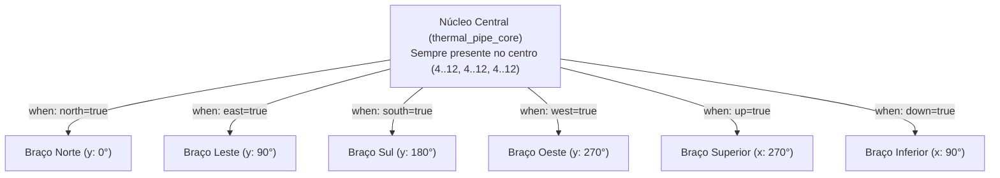
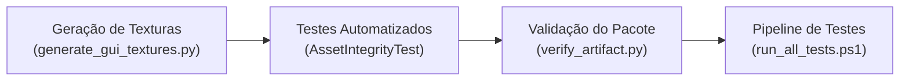

# Diretrizes Oficiais de Texturas, Modelos e Interfaces (Crop Manager)

Este documento define as especificações normativas de design, paletas de cores, dimensões, modelos 3D, animações e interfaces gráficas (GUIs) do mod **Crop Manager** para **Minecraft 1.12.2** (Cleanroom / Forge / RetroFuturaGradle).

Todas as diretrizes aqui estabelecidas baseiam-se em medições pixel a pixel dos arquivos de textura (`.png`), classes de renderização Java (`src/main/java/br/cropmanager/`), modelos JSON e scripts de auditoria do repositório (`tools/`).

---

## 1. Identidade Visual e Paleta Oficial (Hex)

O Crop Manager adota rigorosamente a estética industrial e funcional do **IndustrialCraft 2 (IC2 Experimental 2.8.222-ex112)**: tons metálicos neutros (cinza aço frio), relevos 3D sutis de 1px, chanfros mecânicos e visores digitais de alto contraste.

### 1.1 Paleta de Chassi de Máquinas e Elementos Estruturais

Extraída diretamente dos chassis auditados do IC2 (Macerator, Crop-Matron, Pump, Crop Harvester) e implementada em `tools/generate_process_textures.py` e `docs/artwork/ic2-palette.json`:

| Elemento / Função | Hex | RGB | Aplicação |
| :--- | :---: | :---: | :--- |
| **Sombra Profunda (Contorno Externo)** | `#1C2226` | `(28, 34, 38)` | Contornos mais externos e ranhuras profundas |
| **Borda Sombreada / Chanfro Interno** | `#465056` | `(70, 80, 86)` | Linhas de sombra nas bordas 3D de painéis e aletas |
| **Aço Estrutural (Chassi Principal)** | `#707A80` | `(112, 122, 128)` | Base das placas metálicas e perfis de maquinário |
| **Cinza Médio (Rebaixo / Miolo)** | `#5B656B` | `(91, 101, 107)` | Área central chanfrada de blocos e tubulações |
| **Cinza Escuro (Cavidade Mecânica)** | `#2B3237` | `(43, 50, 55)` | Fundos de grelhas, frestas de ventilação e entradas |
| **Borda Iluminada (Highlight 3D)** | `#B0B8BC` | `(176, 184, 188)` | Linhas de topo e esquerda em relevos mecânicos |
| **Brilho de Rebites (Rebite Ativo)** | `#DDE1E0` | `(221, 225, 224)` | Ponto superior esquerdo de parafusos/rebites |
| **Cavidade Negra (Fundo de Motor/Abertura)**| `#111619` | `(17, 22, 25)` | Aberturas funcionais internas e calhas |

### 1.2 Paleta Oficial de Interfaces Gráficas (GUIs - Modo Claro IC2)

Medida a partir de `assets/ic2/textures/gui/common.png`, `guicropmatron.png` e padronizada em `tools/generate_gui_textures.py`:

| Elemento | Hex | RGB | Uso na Interface |
| :--- | :---: | :---: | :--- |
| **Fundo Principal (Panel Body)** | `#C6C6C6` | `(198, 198, 198)` | Superfície plana da janela e painéis 9-slice |
| **Borda Iluminada (3D Edge)** | `#FFFFFF` | `(255, 255, 255)` | Borda superior e esquerda (luz direta de 1px) |
| **Sombra Intermediária (3D Shadow)**| `#555555` | `(85, 85, 85)` | Borda inferior/direita e contornos de rebaixo |
| **Sombra Profunda (Deep Shadow)** | `#373737` | `(55, 55, 55)` | Contorno externo do painel e poço de slots |
| **Fundo de Slot Padrão** | `#8B8B8B` | `(139, 139, 139)` | Miolo 16×16 de slots de inventário e máquinas |
| **Painel Rebaixado Escuro** | `#B4B4B4` | `(180, 180, 180)` | Fundo da grade de produtos e bandejas internas |
| **Painel Rebaixado Médio** | `#BCBCBC` | `(188, 188, 188)` | Fundo de abas recolhíveis e barras de ferramentas |
| **Ícone Fantasma de Slot (Desativado)** | `#555555` | `(85, 85, 85)` | Glifo indicador de tipo de item em slot vazio |
| **Ícone Fantasma (Highlight)** | `#A8A8A8` | `(168, 168, 168)` | Realce sutil em glifos customizados de slot |
| **Fundo de Medidores (Well)** | `#262626` | `(38, 38, 38)` | Cavidade interna de tanques e barras de nível |

### 1.3 Cores Semânticas de Dados, Fluidos e Alertas (Código Java)

Cores hexadecimais utilizadas em barras (`Gui.drawRect`), renderizadores e tipografia (`FarmGuiStyle.java`, `ManagerGui.java`, `EquipmentGui.java`):

| Semântica / Recurso | Hex | Renderizador / Constante | Descrição |
| :--- | :---: | :---: | :--- |
| **Energia Elétrica (EU Ativo / Raio)** | `#C93424` / `#FF5555` | `0xffff5555` | Preenchimento de raio EU e indicador elétrico |
| **Energia Elétrica (Tique Alerta)** | `#8E2820` | `gauge_tick_red` | Marcadores críticos de buffer elétrico |
| **Água (Water Tank / Indicador)** | `#438CBD` / `#2A82BF` | `0xff438cbd` | Fluido nos tanques do Monitor, Composteira e Extrator |
| **Água (Highlight Superfície)** | `#73C1E4` | `water_hi` | Linha superior de menisco d'água |
| **Weed-Ex (Defensivo Agrícola)** | `#B9A247` / `#DDCC55` | `0xffb9a247` | Fluido Weed-Ex em reservatórios e gráficos |
| **Biogás / Extrato de Grin** | `#83AA55` / `#5A974A` | `0xff83aa55` | Tanque de biogás do Capinador e extrato vegetal |
| **Progresso de Processamento** | `#76A74B` / `#329646` | `0xff76a74b` | Barras horizontais de conclusão (Composteira/Grinder) |
| **Cobre / Condução Térmica (HU)** | `#945B2A` | `copper` | Anéis térmicos, grelhas e conectores de calor |
| **Ouro / Conexão Nobre / Alerta** | `#C89D41` / `#FFAA44` | `0xffffaa44` | Terminais de contato e alertas de estado |
| **Operação Normal (Good Ink)** | `#245D37` (claro) / `#9CDEB0` (escuro) | `FarmGuiStyle.goodInk()` | Status funcional, texto de prontidão e botões ativos |
| **Alerta / Erro (Warning Ink)** | `#922D20` (claro) / `#FFB08A` (escuro) | `FarmGuiStyle.warningInk()` | Faltas (energia, água, espaço) e alarme ativado |
| **Texto Padrão (Default Ink)** | `#202020` (claro) / `#F0F0F0` (escuro) | `FarmGuiStyle.ink()` | Rótulos, títulos em negrito e valores do painel |
| **Texto Silenciado (Muted Ink)** | `#555555` (claro) / `#BCBCBC` (escuro) | `FarmGuiStyle.mutedInk()` | Informações secundárias e botões inativos |

---

## 2. Blocos e Máquinas (`16×16`)

### 2.1 Padrão de Resolução e Estrutura do Bloco
- **Tamanho Real:** Toda face de bloco deve possuir exatamente **16×16 pixels reais** (modo de cor RGBA 8-bit, sem anti-aliasing interpolado).
- **Sem Interpolação:** Nenhuma cor intermediária deve ser gerada por filtros de reamostragem bilinear/bicúbica.
- **Estrutura das Faces (Chassi Compartilhado):**
  - **`_top.png`**: Placa de aço com rebaixo chanfrado central e grade de respiro ou conector.
  - **`_bottom.png`**: Chassi reforçado plano com pés ou cantoneiras estruturais.
  - **`_side.png` / `_back.png`**: Carcaça cinza fria com faixas de rebites nos cantos e grelhas de ventilação mecânica.
  - **`_front.png`**: Painel frontal de controle contendo a interface funcional do bloco (visores, orifícios de entrada de itens ou lâmpadas indicadoras).

### 2.2 Estado Ativo Animado (`_front_active.png` e `.mcmeta`)
As máquinas do Crop Manager comunicam visualmente ao jogador quando estão operando no mundo através de texturas frontais animadas com empilhamento vertical de frames:

| Bloco | Textura Ativa | Dimensões | Frames | Arquivo `.mcmeta` Obrigatório | Comportamento Animado |
| :--- | :--- | :---: | :---: | :--- | :--- |
| **Advanced Crop Manager** | `advanced_crop_manager_front_active.png` | 16×32 | 2 | `{"animation":{"frametime":8,"interpolate":false}}` | LED indicador de varredura alternando pulso verde/azul |
| **Electric Composter** | `electric_composter_front_active.png` | 16×32 | 2 | `{"animation":{"frametime":8,"interpolate":false}}` | Misturador interno com rotação cíclica sob o visor |
| **Grin Grinder** | `grin_grinder_front_active.png` | 16×64 | 4 | `{"animation":{"frametime":4,"interpolate":false}}` | Lâminas de trituração rotacionando em 4 fases contínuas |
| **Grin Extractor** | `grin_extractor_front_active.png` | 16×64 | 4 | `{"animation":{"frametime":5,"interpolate":false}}` | Ebulição e circulação de vapor/extrato verde sob aquecimento |
| **Agricultural Monitor** | `agricultural_monitor_front_active.png` | 16×16 | 1 | *(Estático por troca de modelo no blockstate)* | Visor frontal iluminado com sinal de status ativo |
| **Biogas Weeder** | `biogas_weeder_front_active.png` | 16×16 | 1 | *(Controlado via modelo 3D ativo no blockstate)* | Queimadores e cabeçote de corte em posição de capina |

> [!IMPORTANT]
> O arquivo `.mcmeta` deve **sempre** especificar `"interpolate": false`. A interpolação linear do OpenGL borra o estilo pixel art e descaracteriza a estética de maquinário do IC2.

---

## 3. Tubos, Cabos e Conexões

### 3.1 Modelo Multipart do Tubo Térmico (`thermal_pipe`)
O transporte térmico (`HU` - Heat Units) utiliza o bloco `thermal_pipe`, modelado como um sistema **multipart conectado** em `src/main/resources/assets/cropmanager/blockstates/thermal_pipe.json`:

### 3.2 Regras Normativas de Conexão
1. **Sem Pontas Soltas:** Braços (`thermal_pipe_arm.json`) são renderizados **estritamente** para as direções onde há um vizinho compatível (máquinas térmicas ou outro tubo). Nunca renderizar flange aberta no ar.
2. **Textura do Tubo (`thermal_pipe.png`):** Tubo de aço fosco (`#707A80`) envolto por anéis condutores de cobre (`#945B2A`) e reforços de ouro (`#C89D41`), identificando o fluido térmico por uma faixa azul central (`#2D7EA4` / `#61B6CF`).
3. **Colarinho de Engate (`thermal_pipe_collar.png`):** Encaixe mecânico quadrado chanfrado com recuo escuro (`#2B3237`) para fixação firme na máquina adjacente.

---

## 4. Itens e Upgrades (`16×16`)

Todos os itens do mod respeitam a resolução **16×16 pixels** (com exceção do `portable_crop_database.png`, cuja arte de alta definição é rasterizada e mantida em 32×32):

| Item | Arquivo de Textura | Dimensões | Silhueta Base e Identificação Visual |
| :--- | :--- | :---: | :--- |
| **Wireless EU Upgrade** | `wireless_eu_upgrade.png` | 16×16 | Chip padrão IC2 com carcaça cinza `#252B30`, bisel `#71828B`, rebaixo escuro `#14191E`, núcleo de energia vermelho `#C93424` com raio dourado `#FFD84A` e pinos de ouro `#B5A05C` |
| **Wireless Range Upgrade** | `wireless_range_upgrade.png` | 16×16 | Chip com antena de emissão e anéis de expansão de alcance |
| **Weed Killer Upgrade** | `weed_killer_upgrade.png` | 16×16 | Chip de controle químico com reservatório e marca verde |
| **Harvest Transfer Upgrade**| `harvest_transfer_upgrade.png`| 16×16 | Chip com seta de transferência de inventário para baús |
| **Upgrade Linker** | `upgrade_linker.png` | 16×16 | Ferramenta de sintonia e ligação de alvos para a Crop Database |
| **Agricultural Probe** | `agricultural_probe.png` | 16×16 | Sonda de análise de terreno com ponta de prova e visor |
| **Grinding Blade** | `grinding_blade.png` | 16×16 | Lâmina circular de aço temperado com dentes de corte afiados |
| **Weed-Ex Fabricator** | `weed_ex_fabricator.png` | 16×16 | Miniatura isométrica do misturador químico para inventário |
| **Portable Crop Database** | `portable_crop_database.png` | 32×32 | Terminal portátil emborrachado com tela de dados |

---

## 5. Interfaces (GUIs) e Atlas de Widgets

### 5.1 Especificações da Folha de Textura (PNG)
- **Painéis de Máquinas Complexas (`512×512`):** As interfaces de máquinas industriais (`equipment_monitor`, `manager_advanced`, `equipment_composter`, `equipment_grinder`, `equipment_extractor`, `equipment_mixer`) são geradas em folhas de **512×512 pixels** (RGBA 8-bit) para acomodar o painel principal, painéis laterais retráteis (sidebar) e inventário do jogador sem compressão de layout.
- **Crop Database Chest (`256×256` e `128×128`):** Folha principal `crop_database_chest.png` em **256×256** e gaveta retrátil `crop_database_drawer.png` em **128×128**.
- **Grade Canônica de Slots (`18×18`):** Todo slot de item possui dimensões externas de **18×18 pixels**, com área útil central de **16×16 pixels** (deslocamento de 1px para a borda superior/esquerda).

### 5.2 Atlas de Coordenadas UV de Widgets Reutilizáveis

Tabela auditada confrontando o código de renderização (`FarmGuiStyle.java`), arquivos PNG e scripts de geração:

| Widget / Glifo | Folha de Textura | UV Origem (`U`, `V`) | Dimensões (`L` × `A`) | Tamanho Renderizado | Chamada no Código |
| :--- | :--- | :---: | :---: | :---: | :--- |
| **Painel 9-Slice (Janela IC2)** | `ic2:textures/gui/common.png` | `(16, 16)` | 64×64 | Escalável (cantos 8×8) | `FarmGuiStyle.panel(...)` |
| **Slot Padrão 18×18** | `ic2:textures/gui/common.png` | `(103, 7)` | 18×18 | 18×18 | `FarmGuiStyle.slot(...)` |
| **Slot de Fertilizante** | `ic2:textures/gui/guicropmatron.png` | `(10, 56)` | 18×18 | 18×18 | `EquipmentContainer` |
| **Slot de Cápsula de Fluido** | `ic2:textures/gui/guicropmatron.png` | `(48, 26)` | 18×18 | 18×18 | `EquipmentContainer` |
| **Raio EU (Vazio)** | `cropmanager:textures/gui/ic2_widgets.png` | `(111, 24)` | 7×13 | 7×13 | `FarmGuiStyle.bolt(...)` |
| **Raio EU (Cheio / Vermelho)** | `cropmanager:textures/gui/ic2_widgets.png` | `(110, 7)` | 7×13 | 7×13 (proporcional) | `FarmGuiStyle.bolt(...)` |
| **Alerta Crítico (Triângulo)** | `cropmanager:textures/gui/ic2_widgets.png` | `(161, 8)` | 30×26 | 16×14 | `FarmGuiStyle.warningTriangle(true)` |
| **Aviso / Atenção (Triângulo Amarelo)** | `cropmanager:textures/gui/ic2_widgets.png` | `(162, 37)` | 30×26 | 16×14 | `FarmGuiStyle.warningTriangle(false)` |
| **Seta de Reciclagem (Inativa)** | `cropmanager:textures/gui/ic2_widgets.png` | `(135, 9)` | 18×17 | 18×17 | `FarmGuiStyle.recycle(false)` |
| **Seta de Reciclagem (Ativa)** | `cropmanager:textures/gui/ic2_widgets.png` | `(135, 30)` | 18×17 | 18×17 | `FarmGuiStyle.recycle(true)` |
| **Chamas de Calor (Inativas)** | `ic2:textures/gui/common.png` | `(97, 81)` | 13×13 | 13×13 | `FarmGuiStyle.heat(false)` |
| **Chamas de Calor (Acesas)** | `ic2:textures/gui/common.png` | `(112, 80)` | 13×13 | 13×13 | `FarmGuiStyle.heat(true)` |
| **Escala de Tanque (Tiques Verdes)** | `ic2:textures/gui/common.png` | `(46, 109)` | 8×37 | 8 × min(37, h-6) | `FarmGuiStyle.tankScale(...)` |
| **Botão de Info Azul** | `ic2:textures/gui/infobutton.png` | `(0, 0)` | 10×10 | 10×10 | `FarmGuiStyle.info(...)` |

### 5.3 Grade de Ícones Semânticos (`icons.png` - 64×64 Grid 4×4 de 16×16)

Renderizados via `FarmGuiStyle.icon(x, y, col, row)`:

| Coluna (`X`), Linha (`Y`) | Ícone | Função e Estado |
| :---: | :--- | :--- |
| **`(0, 0)`** | Chave de Força Verde | Máquina Ligada (`Enabled: true`) |
| **`(1, 0)`** | Chave de Força Vermelha | Máquina Desligada (`Enabled: false`) |
| **`(2, 0)`** | Tocha / Sinal Desativado | Redstone Modo 0 (Ignorar sinal) |
| **`(3, 0)`** | Tocha / Sinal Ativo | Redstone Modo 1 (Ativo com sinal) |
| **`(0, 1)`** | Tocha Invertida | Redstone Modo 2 (Ativo sem sinal) |
| **`(1, 1)`** | Foice / Colheita Verde | Colheita Automática Habilitada |
| **`(2, 1)`** | Foice / Colheita Cinza | Colheita Automática Desabilitada |
| **`(3, 1)`** | Engrenagem / Checkmark | Estado de Operação Nominal |
| **`(1, 2)`** | Estrela Dourada Preenchida | Filtro de Favoritos Apenas (Crop Database) |
| **`(2, 2)`** | Estrela de Contorno | Todos os Itens (Crop Database) |
| **`(3, 2)`** | Tela / Gráfico de Dados | Aba de Operação / Diagnóstico |
| **`(0, 3)`** | Caixa Delimitadora / Grid | Aba de Seleção de Área |

### 5.4 Regras Normativas de UX e Layout
1. **Tipografia e Hierarquia:**
   - Títulos de janelas e seções **devem** utilizar negrito nativo (`\u00a7l`) através de `FarmGuiStyle.title(...)`.
   - Números e unidades devem usar notação padronizada via `UiNumbers` (ex.: `12,6k mB`, `32 EU/t`).
2. **Visores Digitais Planos (Flat Black Display):**
   - Visores eletrônicos (como o painel digital do Advanced Manager) devem ser renderizados sobre fundo preto plano `0xff000000` (`FarmGuiStyle.digitalScreen`), **sem relevo 3D ou chanfros de borda** no miolo do visor.
3. **Proibição de Separadores Poluídos:**
   - É expressamente proibido o uso de barras `/` como divisores soltos em rótulos densos (ex.: usar `"10 EU/t · Pronto"` em vez de `"10 EU/t / Pronto"`).
4. **Padronização de Botões e Tooltips:**
   - Botões interativos devem ter altura padrão de **14px** (ou **14×14px** para seletores `+`, `−`, `<` e `>`).
   - Todo botão com ícone deve conter **tooltip detalhado em 3 linhas**:
     - Linha 1: Título da ação em negrito.
     - Linha 2: Estado atual com cor semântica (`\u00a7a Ligado`, `\u00a7c Desligado`, `\u00a7e Pulso`).
     - Linha 3: Explicação do efeito ao clicar.

---

## 6. Resource Pack / Dark Mode

O projeto conta com suporte oficial e completo a tema escuro distribuído como Resource Pack (`dist/CropManager-GUI-Dark-0.5.0-alpha9.zip`).

### 6.1 Detecção Dinâmica de Tema no Código
O mod não necessita de configurações manuais para o modo escuro. Em `FarmGuiStyle.java`, a cor do texto adapta-se em tempo de execução ao recurso gráfico carregado medindo a luminância do pixel `(10, 10)` da textura `equipment_monitor.png`:
$$\text{Luminância} = 0.2126 \times R_{\text{linear}} + 0.7152 \times G_{\text{linear}} + 0.0722 \times B_{\text{linear}}$$
- Se $\text{Luminância} < 0.179$, ativa o modo escuro (`lightText = true`, texto `#F0F0F0`).
- Caso contrário, mantém o modo claro clássico (`lightText = false`, texto `#202020`).

### 6.2 Tabela de Conversão de Paleta (Claro → Escuro)

Implementada no conversor de pixels `tools/generate_gui_textures.py`:

| Componente | Modo Claro (Original IC2) | Modo Escuro (Dark Pack) | Regra de Mapeamento |
| :--- | :---: | :---: | :--- |
| **Painel Principal** | `#C6C6C6` | `#252A30` | Tons neutros $v \in [180, 229]$ |
| **Borda Iluminada (Highlight)** | `#FFFFFF` | `#626B74` | Tons neutros $v \ge 230$ |
| **Borda Sombreada** | `#555555` | `#080B0F` | Tons neutros $v \in [70, 109]$ |
| **Sombra Profunda** | `#373737` | `#05080C` | Tons neutros $v \in [30, 69]$ |
| **Fundo de Slot** | `#8B8B8B` | `#11171D` | Tons neutros $v \in [135, 179]$ |
| **Rebaixo Intermediário** | `#7E7D7D` | `#181F26` | Tons neutros $v \in [110, 134]$ |
| **Contorno Externo Negro** | `#000000` | `#040609` | Contornos periféricos $v < 30$ |
| **Cores Semânticas** | *(Raios, fluidos, leds)* | **Preservadas** | Pixels onde $(\max - \min) > 6$ não sofrem alteração |
| **Telas Digitais** | `#000000` | `#000000` | Fundo preto absoluto preservado |

---

## 7. Checklist de Validação

Antes de publicar qualquer versão, adicionar novas texturas ou alterar modelos, execute a lista de verificação abaixo:

### Itens de Conformidade Obrigatória:
- [ ] **Resolução de Blocos e Itens:** Todos os blocos possuem faces de `16×16` pixels; itens regulares possuem `16×16`.
- [ ] **Resolução de Interfaces:** GUIs complexas possuem folhas de `512×512` pixels; telas secundárias possuem `256×256` ou `128×128`.
- [ ] **Cabeçalho PNG Válido:** Todos os PNGs exportados possuem profundidade de cor de 8-bit com canal Alpha (bits=8, mode=6).
- [ ] **Animações `.mcmeta`:** Todo arquivo `*_front_active.png` com altura múltipla de 16 possui um `.mcmeta` associado com `"interpolate": false` e `"frametime" > 0`.
- [ ] **Alinhamento Slot vs. Container:** As coordenadas de slots definidas nas classes Java (`EquipmentContainer`, `ManagerContainer`, `ContainerCropDatabaseChest`) coincidem milimetricamente com os slots desenhados na textura da GUI.
- [ ] **Modelos JSON e Blockstates:** Não existem referências a texturas inexistentes (testado por `AssetIntegrityTest.everyBlockAndItemHasModelsAndTextures`).
- [ ] **Simetria de Localização:** Todas as chaves em `en_us.lang` possuem tradução correspondente em `pt_br.lang`.
- [ ] **Suporte a Dark Mode:** O pacote `dist/CropManager-GUI-Dark-*.zip` foi regenerado sincronizado via `python tools/generate_gui_textures.py`.
