# CurseForge & Modrinth Publishing Kit — IC2: Agronomy Expansion

Este documento reúne todos os metadados, caminhos de imagens e o código-fonte completo da descrição (**Markdown**) pronto para você copiar e colar na página de criação do projeto no **CurseForge** e no **Modrinth**.

---

## 1. Metadados Recomendados para o Formulário da CurseForge

- **Project Name:** `IC2: Agronomy Expansion` *(ou `IC2: Agronomy Expansion (Crop Manager)`)*
- **URL Slug Sugerido:** `ic2-agronomy-expansion`
- **Summary (Descrição Curta - máx. 255 caracteres):**
  > IndustrialCraft 2 Experimental addon for Minecraft 1.12.2 featuring 3D crop automation, Weed-Ex & Biogas chemistry, seed genetics analysis, 500-slot seed database, 3x5x3 fluid/item multiblocks, wireless Wi-Fi EU grid, hydroponics, and 15 custom crops.
- **Primary Category:** `Technology`
- **Secondary Categories:** `Technology - Farming`, `Technology - Energy, Fluid, and Item Transport`, `Technology - Processing`, `Addons - Industrial Craft`
- **Game Version:** `Minecraft 1.12.2`
- **Modloader:** `Forge` (Compatível com **Cleanroom Loader**)
- **Required Dependency:** `Industrial Craft` (`2.8.222-ex112`)
- **Optional Dependency:** `Had Enough Items (HEI)` / `Just Enough Items (JEI)`
- **License:** `MIT License`

---

## 2. Mapa de Arquivos de Imagem (`docs/artwork/curseforge/`)

| Onde usar no CurseForge | Arquivo Recomendado | Resolução |
| :--- | :--- | :--- |
| **Project Avatar (Logo Quadrada)** | `docs/artwork/curseforge/logo/curseforge_avatar_512.png` *(ou `1024.png`)* | `512×512` / `1024×1024` |
| **Topo da Descrição (Hero Banner)** | `docs/artwork/curseforge/banner/hero_banner_compact.png` *(ou `1920x1080.png`)* | `1920×600` / `1920×1080` |
| **Aba Images / Gallery (Card 1)** | `docs/artwork/curseforge/gallery/01_advanced_crop_automation.png` | `1920×1080` |
| **Aba Images / Gallery (Card 2)** | `docs/artwork/curseforge/gallery/02_chemical_weed_management.png` | `1920×1080` |
| **Aba Images / Gallery (Card 3)** | `docs/artwork/curseforge/gallery/03_seed_genetics_database.png` | `1920×1080` |
| **Aba Images / Gallery (Card 4)** | `docs/artwork/curseforge/gallery/04_multiblock_logistics.png` | `1920×1080` |
| **Aba Images / Gallery (Card 5)** | `docs/artwork/curseforge/gallery/05_wifi_energy_and_greenhouse.png` | `1920×1080` |
| **Divisores de Seção na Descrição** | `docs/artwork/curseforge/sections/header_*.png` | `900×120` |

> **Dica para incorporar imagens na descrição do CurseForge:**
> Suba primeiro os arquivos de `banner/`, `gallery/` e `sections/` na aba **Images** do seu projeto no CurseForge (ou hospede no GitHub do repositório), clique com o botão direito na imagem enviada → *Copy Image Address* e substitua os caminhos relativos no template abaixo.

---

## 3. Template da Descrição (Copy & Paste Markdown para CurseForge / Modrinth)

````markdown
<p align="center">
  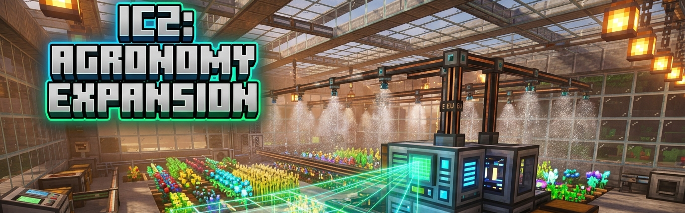
</p>

<p align="center">
  
  
  
  
</p>

<p align="center">
  <b>IC2: Agronomy Expansion</b> (<i>Crop Manager</i>) transforms traditional <b>IndustrialCraft 2 Experimental</b> agriculture into a full-scale industrial ecosystem. Engineer automated multi-layer farms, synthesize Weed-Ex and Biogas, decode crop genetics, store hundreds of seeds in indexed databases, erect <code>3×5×3</code> fluid and item multiblocks, and beam wireless EU across your facility!
</p>

---

<p align="center">
  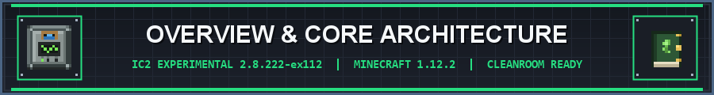
</p>

### Why IC2: Agronomy Expansion?
While native IC2 provides a deep cross-breeding and crop stat system (`Growth`, `Gain`, `Resistance`), scaling it up in mid-to-late game often requires complex workarounds. **IC2: Agronomy Expansion** bridges that gap with native-feeling IC2 machines, zero chunk-loading lag, classic IC2 UI with an optional Dark Theme (`#1C1C1D`) Resource Pack and automatic text-contrast adaptation, and complete **HEI / JEI** and **In-Game Manual** documentation.

- **Chunk-Safe 3D Scanning:** Never force-loads neighbor chunks; configurable scan radius (`3×3` up to `17×17`) across 3 vertical layers with 3D offset controls.
- **Complete Chemical & Biogas Loop:** Turn spider eyes, redstone, and organic waste into **Grin Extract**, **Weed-Ex**, **IC2 Fertilizer**, and **Biogas**.
- **Deep Genetics & Storage:** Analyze seeds up to Level 4 and organize up to **500 Seed Bags** per database chest with search, sorting, favorites, and interdimensional remote access.
- **Heavy Multiblocks & Wireless Power:** Build `3×5×3` Reservoirs, Fluid Tanks, and Silos, and power your greenhouses through a **1,000-channel Wi-Fi EU Grid**.

---

<p align="center">
  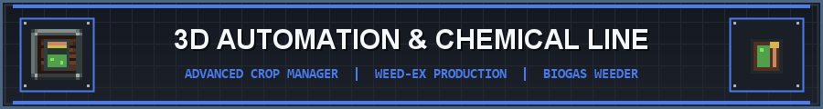
</p>

<p align="center">
  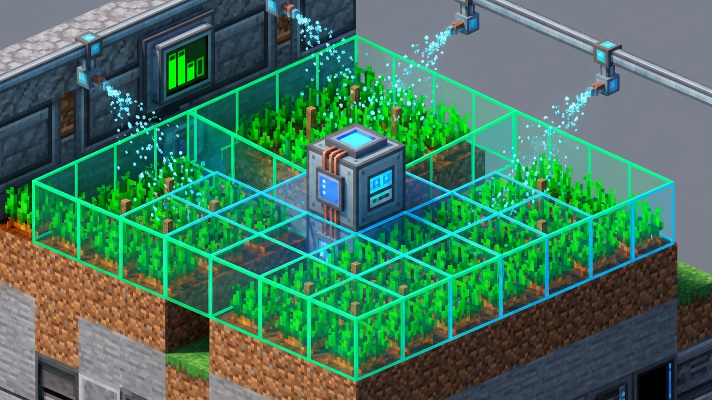
</p>

### Advanced Crop Manager & Remote Telemetry
- **Advanced Crop Manager (`advanced_crop_manager`):** Tier 2 EU machine (`100,000 EU` buffer, dual `20,000 mB` Water & Weed-Ex tanks, 26 slots). Automatically hydrates, fertilizes, applies Weed-Ex, and harvests mature crops across up to 3 vertical layers (`below / level / above`) with customizable 3D area offset (`offsetX/Y/Z`). Includes an integrated **Data Survey** tab displaying planted species and real soil nutrient, hydration, air quality, and light readings.
- **Agricultural Probe & Monitor (`agricultural_probe`, `agricultural_monitor`):** Link your Manager, Weeder, or IC2 Crop-Matron remotely (up to `512` blocks with *Wireless Range Upgrades*). Configure automated **Stop Rules** (pausing machines based on fluid, fertilizer, EU, or output thresholds with Weed-Ex hysteresis protection) and redstone alarms.
- **Rotational & Diagonal Sprinklers (`sprinkler_mk1`–`mk3`, `sprinkler_diagonal`):** Zero-EU 3D animated sprinklers hydrating farmland and IC2 crop sticks up to `17×17` with up to `4×` growth acceleration, plus a 4-quadrant Diagonal Sprinkler that leaves a dry cross walkway for players.

<p align="center">
  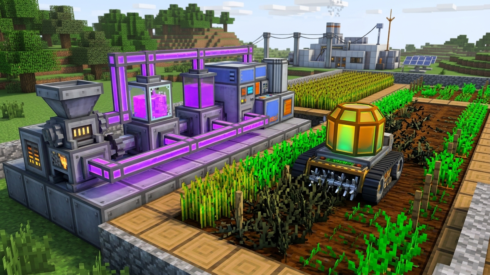
</p>

### Weed-Ex Chemical Line, Composters & Biogas Weeder
- **Biogas Weeder (`biogas_weeder`):** Dedicated zero-EU 3D machine fueled by a `16,000 mB` **IC2 Biogas** tank. Extracts real weeds (`Crops.weed`) without breaking crop sticks or tall crops, outputting IC2 Weed items for composting.
- **Grin Grinder → Grin Extractor → Weed-Ex Fabricator:** Industrial Tier 1 pipeline that grinds spider eyes into **Grin Powder**, extracts **Grin Extract** (`1,000 mB`), and synthesizes liquid **Weed-Ex** (`500 mB`) with redstone.
- **Manual & Electric Composters:** Convert organic waste and weeds into **Organic Compost** early on, or automate **IC2 Fertilizer** production (`4 organic items + 1,000 mB water → 1 IC2 Fertilizer`).

---

<p align="center">
  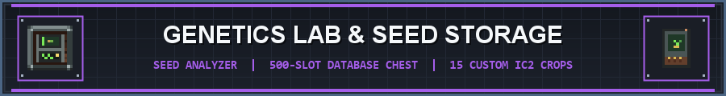
</p>

<p align="center">
  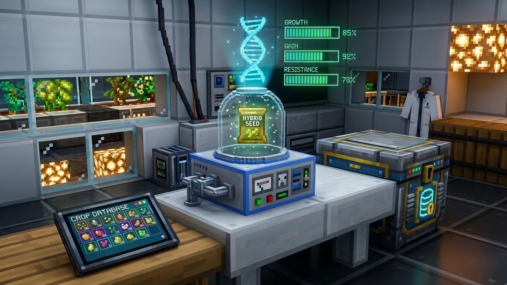
</p>

### Seed Analyzer, Indexed Database & 15 Custom IC2 Crops
- **Seed Analyzer (`seed_analyzer`):** Tier 1 EU machine (`100` ticks at `5 EU/t`) that scans IC2 Seed Bags up to Level 4 and displays complete genetics and Growth/Gain/Resistance bars.
- **Crop Database Chest & Portable Database:** Stores up to **500 Seed Bags** in a paginated `5×5` grid with instant text search, stat/tier sorting, non-destructive favorites, magnetic pickup, and **interdimensional wireless access** via the **Upgrade Linker**.
- **Pollinator Hive, Crossing Tool & Greenhouse Glass:** Accelerate double crop-stick cross-breeding (up to `3×` cadence with **Mutagenic Powder**) and harvest/rearm crossing sticks effortlessly.
- **15 Custom IC2 Crop Species:** Cultivate resource-producing and exotic flora including *Grinbloom*, *Bioreed*, *Nitrobulb*, *Glowbloom*, *Sulfurbud*, *Lazuli Bloom*, *Quartzreed*, *Lithivine*, *Irid-Moss*, *Radbloom* (grown on *Radioactive Soil*), *Resincane*, *Cryolotus*, *Cupric Moss*, *Stannum Herb*, and *Voltreed*.

---

<p align="center">
  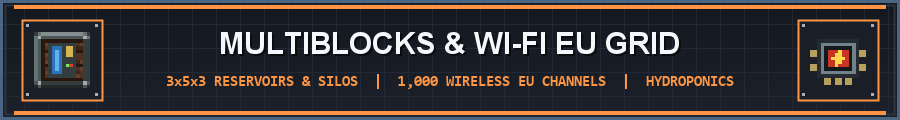
</p>

<p align="center">
  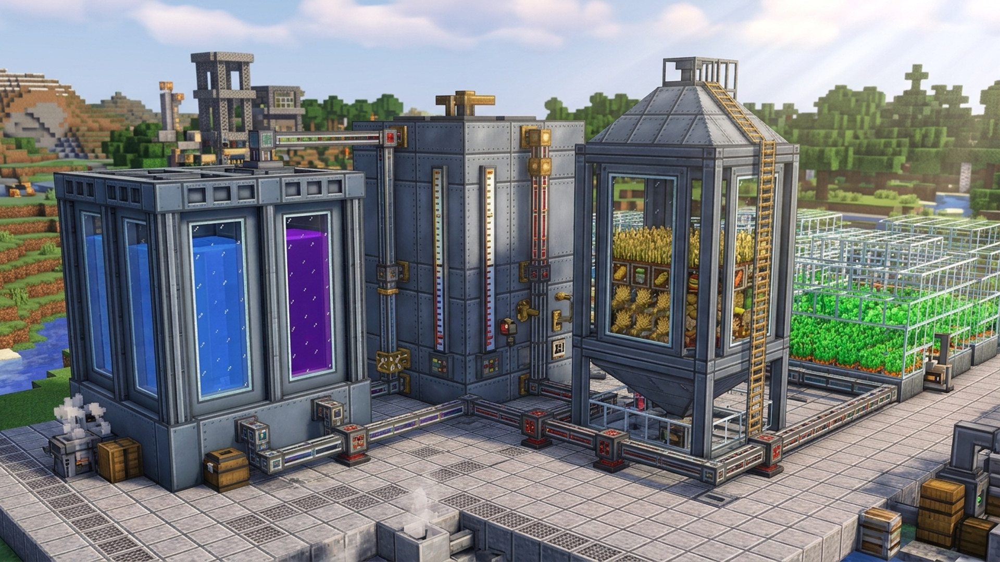
</p>

### Heavy 3×5×3 Multiblocks & Fluid Logistics
- **Agricultural Reservoir (`3×5×3`):** Powered dual-tank multiblock with fluid filters, active pump/reserve modules, and capacity upgrades.
- **Industrial Fluid Tank (`3×5×3`):** Zero-EU bulk single-fluid tank (`128,000 mB` base, expandable up to `384,000 mB` with 8 upgrades), configurable face ports, and redstone auto-extraction.
- **Agricultural Silo (`3×5×3`):** Zero-EU bulk single-item silo (`128,000` items base, expandable up to `384,000` items), template lock, and automated port routing.
- **Fluid Pipes & Thermal Pipe:** Zero-EU Fluid Pipes (automatic tank equalization and multi-branch distribution) plus a `100 HU/t` **Thermal Pipe** for IC2 `IHeatSource` integration.

<p align="center">
  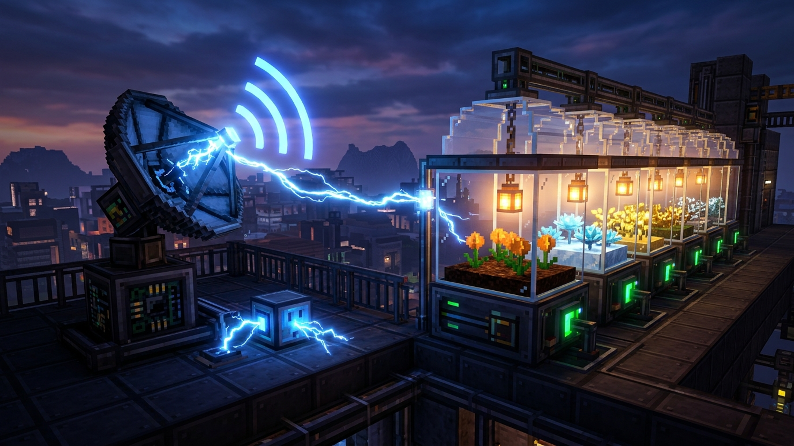
</p>

### Wi-Fi EU Wireless Grid, Hydroponics & Biogas Ecosystem
- **Wi-Fi EU Plug, Point & Dish Antenna:** Broadcast IC2 power across **1,000 public or private channels** (`100,000 EU` smoothing buffer, selectable Tier 1–4 output) and power any IC2 machine equipped with a **Wireless EU Upgrade**.
- **Hydroponic Chamber (`hydroponic_chamber`):** Self-contained Tier 2 growth enclosure (`50,000 EU`, `16 EU/t`) that cultivates IC2 Seed Bags under *Greenhouse Glass*, gaining `+25%` speed from a `3×3` glass dome and `+50%` speed from adjacent IC2 heat sources.
- **Biogas Multiblock Generator (`3×3×3`):** High-detail 3D OBJ/TESR multiblock generator paired with the *Biogas Sprayer* and *Biogas Heat Burner* (`32 HU/t`).
- **Greenhouse Decor & Lighting:** Structural *Greenhouse Frames*, *Garden Trellises*, and light-level-15 *Farm Lanterns*, *Wooden Sconces*, *Industrial Lanterns*, and *Glass Lamps*.

---

<p align="center">
  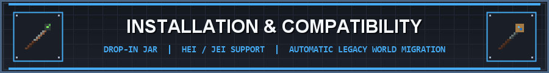
</p>

### Requirements & Installation
1. Install **Minecraft 1.12.2** with **Forge** (or **Cleanroom Loader**).
2. Install **IndustrialCraft 2 Experimental** (`industrialcraft-2-2.8.222-ex112.jar`).
3. Drop `IC2-Agronomy-Expansion-<version>.jar` into your `mods/` folder.
4. *(Optional)* Install **HEI (Had Enough Items)** or **JEI** to browse all custom crop genetics, machine recipes, and fluid processes, or craft the in-game **Agricultural Manual**!
5. *(Optional Dark Theme)* Download `IC2-Agronomy-Expansion-GUI-Dark-0.5.0-alpha11.zip` (`pack_format: 3`, 20 remapped `#1C1C1D` GUI textures) from **Additional Files**, place it in `resourcepacks/`, and enable it in-game.
6. **Documentation:** Full guides in English and Portuguese are available on the [GitHub Wiki](https://github.com/filipeleaalsilva-svg/IC2-Agronomy-Expansion/wiki).

---

<details>
<summary><b>🇧🇷 Resumo em Português (PT-BR) — Clique para expandir</b></summary>

### IC2: Agronomy Expansion (Crop Manager)
Um addon completo de agronomia industrial, automação 3D, genética de sementes, logística de multiblocos e energia sem fio para **Minecraft 1.12.2** e **IndustrialCraft 2 Experimental (`2.8.222-ex112`)**.

- **Automação Agrícola 3D:** O *Advanced Crop Manager* varre áreas de `3×3` a `17×17` em até 3 camadas verticais com deslocamento 3D configurável, sem forçar carregamento de chunks, além de painel de telemetria remota via *Agricultural Monitor* e *Probe*.
- **Linha Química & Biogás:** Produza *Weed-Ex* a partir de olhos de aranha e redstone (*Grin Grinder*, *Grin Extractor*, *Weed-Ex Fabricator*), converta resíduos orgânicos em fertilizante nas composteiras e remova ervas daninhas sem gastar EU com o *Biogas Weeder* 3D.
- **Genética, Banco de Sementes & 15 Culturas:** Analise sementes no *Seed Analyzer*, armazene até 500 sacos de sementes no *Crop Database Chest* (com acesso remoto interdimensional via *Portable Crop Database*), acelere cruzamentos com a *Pollinator Hive* e cultive 15 novas espécies (*Radbloom*, *Irid-Moss*, *Cryolotus*, *Glowbloom*, *Voltreed* e mais).
- **Multiblocos 3×5×3, Hidroponia & Wi-Fi EU:** Construa o *Agricultural Reservoir*, *Industrial Fluid Tank*, *Agricultural Silo* e o *Biogas Generator 3×3×3*, cultive em câmaras fechadas (*Hydroponic Chamber*) e distribua energia em até 1.000 canais sem fio com *Wi-Fi EU Plugs*, *Dish Antenna* e *Wireless EU Upgrade*.
- **Totalmente Localizado:** Interface completa em **Português (pt_BR)** e **Inglês (en_US)** com interface padrão clássica do IC2 e Resource Pack opcional de Tema Escuro (`#1C1C1D`) com contraste adaptativo, suporte a **HEI/JEI** e **Manual Agrícola** ilustrado dentro do jogo.

</details>
````
