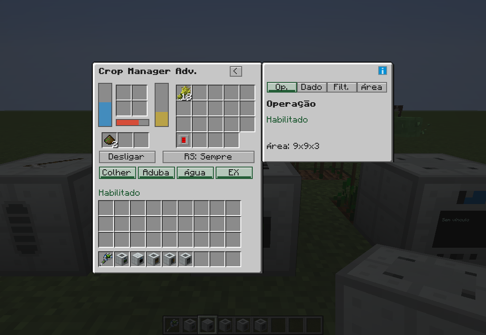
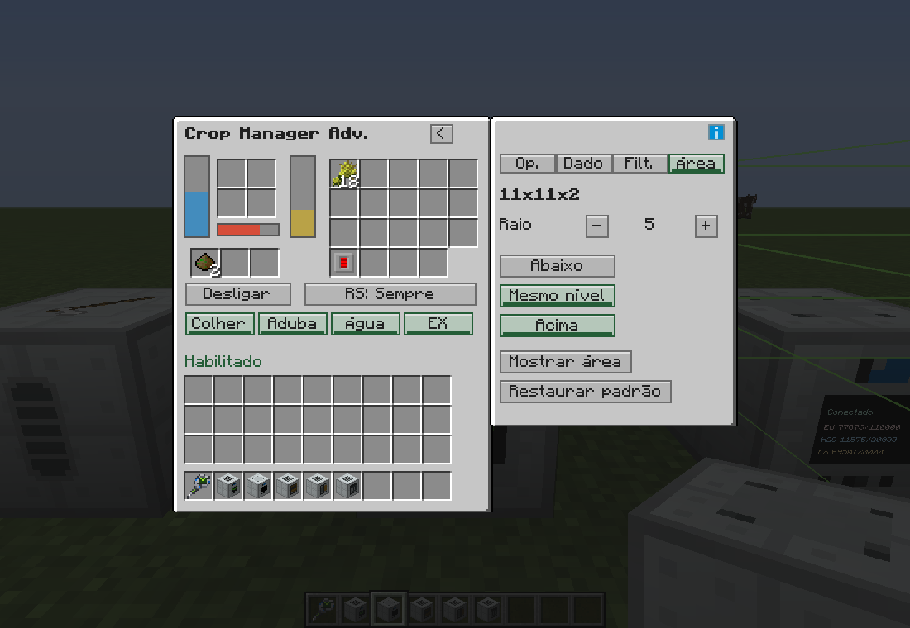
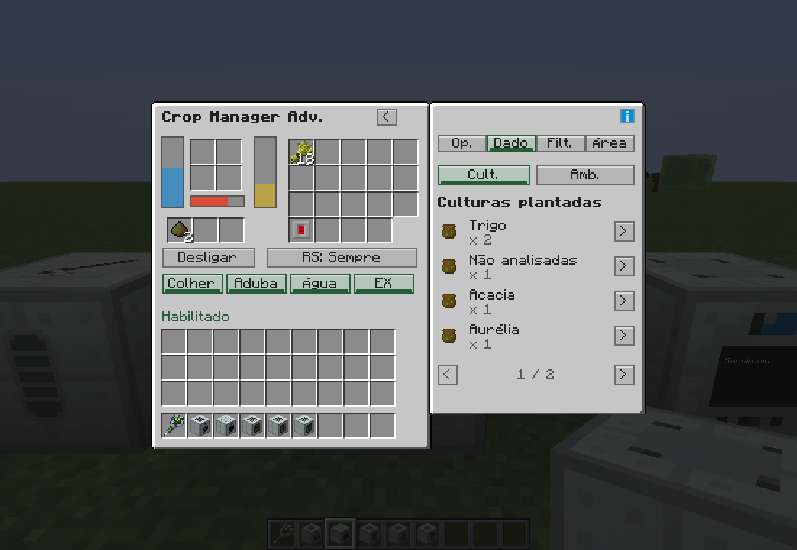
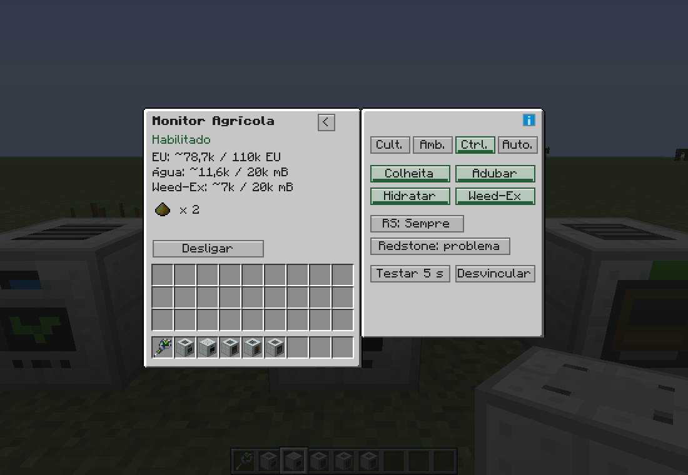
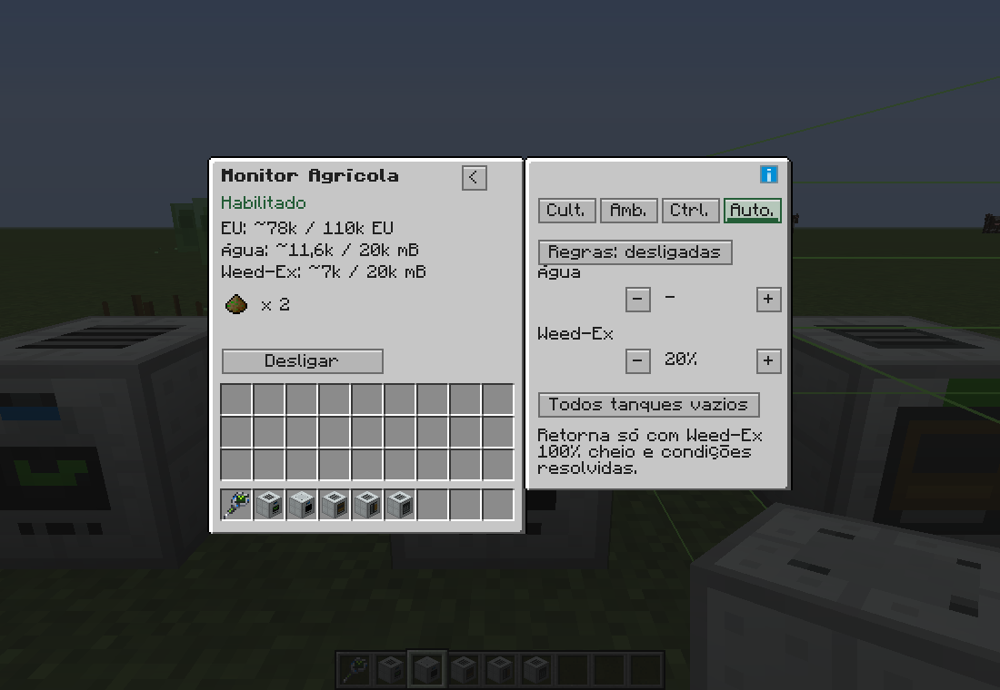

# Automação e Monitoramento

Esta página cobre o núcleo de automação de lavouras do **IC2: Agronomy Expansion**: o **Crop Manager Avançado**, a **Sonda Agrícola** e o **Monitor Agrícola**.

---

## 1. Crop Manager Avançado
*Nome em inglês: **Advanced Crop Manager** · ID: `cropmanager:advanced_crop_manager`*

Máquina central Tier 2 para cuidado completo e colheita automática de estacas de cultivo do IndustrialCraft 2 (`TileEntityCrop`).

### Especificações Técnicas
| Atributo | Valor Padrão |
|---|---|
| **Tier de Entrada** | Tier 2 (base, expansível com `Transformer Upgrade`) |
| **Buffer Interno de EU** | `100.000 EU` (base, expansível com `Energy Storage Upgrade`) |
| **Tanque de Água** | `20.000 mB` |
| **Tanque de Weed-Ex** | `20.000 mB` |
| **Inventário Interno** | 26 slots: adubos, recipientes de fluido, 15 slots de saída e 4 slots de upgrade IC2 |
| **Upgrades Aceitos** | `Overclocker`, `Energy Storage`, `Transformer`, `Weed Killer Upgrade`, `Wireless EU Upgrade` |
| **Velocidade Base** | 1 posição a cada 2 ticks (até 8 posições/tick com Overclockers) |

### Área 3D e Deslocamento
Na aba **Área**, você configura:
* **Raio horizontal:** de `1` (`3×3`) até `8` (`17×17`, limite configurável no servidor até `16`).
* **Camadas verticais:** seleção independente de **Abaixo**, **Mesmo nível** e **Acima** (máscara padrão `7` = todas as 3 camadas).
* **Deslocamento 3D (`offsetX`, `offsetY`, `offsetZ`):** permite deslocar a caixa de varredura para não precisar posicionar a máquina no centro exato da plantação.
* **Pré-visualização local:** botão *Mostrar área* desenha o volume no mundo para o jogador.
* **Chunks:** a máquina **nunca** força carregamento de chunks; posições em chunks descarregados são ignoradas sem custo de EU.

### Ordem de Operação e Consumo de EU
Em cada posição carregada com um cultivo IC2 válido, a ordem de execução é:
1. **Adubar** (aceita Fertilizante IC2, **Composto Orgânico** e **Fertilizante Catalítico**)
2. **Hidratar** (água do tanque interno)
3. **Aplicar Weed-Ex** (e remover ervas daninhas reais caso possua o **Weed Killer Upgrade**, gastando `20 mB` de Weed-Ex por erva)
4. **Colher** (apenas no ponto ótimo ou máximo; sobras ficam em fila NBT persistente e bloqueiam novas colheitas até haver espaço na saída)

Fórmula padrão de energia por ciclo/trecho:
`EU = D × (P + 10 × C + 20 × H)`
* `D`: multiplicador de demanda dos Overclockers instalados
* `P`: posições carregadas consultadas (`1 EU` base)
* `C`: cuidados bem-sucedidos executados (`10 EU` base cada)
* `H`: colheitas concluídas (`20 EU` base cada)

### Filtro Genético e Censo Ambiental
* **Filtro Genético (aba Filtro):** pode operar em dois modos:
  * **Apenas marcar:** apenas sinaliza visualmente plantas fora dos critérios (`Growth / Gain / Resistance` ou espécie de amostra).
  * **Poupar rejeitadas:** pula aplicação de adubo, água e Weed-Ex em plantas fora do filtro, economizando insumos.
* **Censo Integrado (aba Dados):** ao concluir uma volta completa, consolida o total de plantas, maduras, ervas daninhas, não analisadas e as médias reais de **nutrientes do terreno, umidade, qualidade do ar e luz** (respeitando o nível de análise das sementes).

> **Nota de Automação (Ender IO / Conduítes):** Desde a versão `0.5.0-alpha6`, a face inferior (`DOWN`) do Crop Manager Avançado omite intencionalmente `ITEM_HANDLER_CAPABILITY` para evitar crashes (`ClassCastException`) com conduítes do Ender IO 5.5.x em Cleanroom. Utilize qualquer uma das outras 5 faces (`UP`, `NORTH`, `SOUTH`, `EAST`, `WEST`) para entrada e extração de itens.

---

## 2. Sonda Agrícola
*Nome em inglês: **Agricultural Probe** · ID: `cropmanager:agricultural_probe`*

Ferramenta portátil de diagnóstico de campo e vinculação sem fio.

* **Inspeção de Cultivos (`Clique Direito` em uma estaca IC2):** exibe estágio atual, luz, umidade, nutrientes armazenados e cargas de **Solo Catalisado**. Respeita o nível de análise do IC2 (espécie visível a partir do nível 1; genes `GR / GA / RE` apenas no nível 4).
* **Vinculação ao Monitor:**
  1. Segure a Sonda, **agache e clique com o botão direito** em um `Crop Manager Avançado`, `Capinador a Biogás` ou `Crop-Matron` do IC2 para gravar as coordenadas.
  2. Clique com o botão direito em um **Monitor Agrícola** na mesma dimensão para concluir o vínculo.

---

## 3. Monitor Agrícola
*Nome em inglês: **Agricultural Monitor** · ID: `cropmanager:agricultural_monitor`*

Central de telemetria, controle remoto, logística sem fio e saída de alarme Redstone.

### Recursos e Alcance
* **Alcance Base:** `32` blocos na mesma dimensão (dobra a cada **Upgrade de Alcance Wireless**, chegando a `512` blocos com 4 upgrades).
* **Buffers Próprios:** `16.000 mB` de Água, `16.000 mB` de Weed-Ex e `3` slots de fertilizante para envio remoto ao equipamento vinculado.
* **Transferência de Colheitas:** com o **Upgrade de Transferência de Colheitas**, puxa os itens colhidos pelo Manager para um buffer interno extraível por tubos e funis.
* **Energia Wireless:** aceita **Upgrade de Energia Wireless (EU)** para receber EU e alimentar remotamente o alvo vinculado e máquinas de suporte compatíveis em até `16` blocos.
* **Saída Redstone:** configurável em `Desligada`, `Problema` (emite sinal 15 em alertas/paradas), `Operando` (sinal 15 quando ativo e saudável) ou botão `Testar 5 s` (força sinal 15 por 5 segundos).

### Regras de Parada Automática e Histerese
Na aba **Auto.**, o Monitor pode desligar remotamente o Manager caso **ALGUM** ou **TODOS** os limites configurados sejam atingidos (baixa água, baixo Weed-Ex, falta de adubo, baixa energia ou saída cheia).
* **Trava de Histerese do Weed-Ex:** quando uma parada é disparada por falta de Weed-Ex, o Monitor mantém o Manager pausado até que o tanque de Weed-Ex seja reabastecido a **100%** e todas as condições estejam resolvidas, evitando liga/desliga constante e desperdício de energia.

