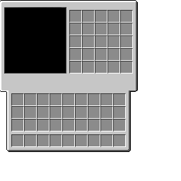

# Genética, Sementes e Cultivos

Esta página reúne as ferramentas de análise e cruzamento genético, o sistema de armazenamento indexado de 500 sementes, o Manual Agrícola e todas as **15 espécies customizadas de crops IC2**.

---

## 1. Análise e Cruzamento Genético

### Analisador de Sementes
*Nome em inglês: **Seed Analyzer** · ID: `cropmanager:seed_analyzer`*

* **Especificações:** Tier 1 (`20.000 EU`, `5 EU/t`, `100` ticks por análise), 4 slots de upgrades IC2 e slot de bateria.
* **Função:** analisa automaticamente `IC2 Seed Bags` até o **nível 4/4** e exibe na interface OLED a espécie, `Growth / Gain / Resistance`, Tier, atributos e selo **Catalisado**.
* Possui saída dedicada compatível com `IItemHandler` para automação em lote.

### Ferramenta de Cruzamento
*Nome em inglês: **Crossing Tool** · ID: `cropmanager:crossing_tool`*

* Armazena estacas de cultivo do IC2 em `3` slots internos (`Shift + Clique Direito` no ar abre o inventário).
* **Clique Direito** em estacas duplas vazias vincula o ponto de cruzamento.
* Ao clicar novamente com o botão direito quando surgir uma muda madura, colhe automaticamente as sementes e consome `1` estaca do estoque interno para rearmar o ponto de cruzamento em um único clique.

---

## 2. Baú de Dados de Cultivos e Database Portátil (500 Slots)

### Baú de Dados de Cultivos
*Nome em inglês: **Crop Database Chest** · ID: `cropmanager:crop_database_chest`*

* Armazena **`500` Sacos de Sementes IC2** em grade paginada `5×5` (`20` páginas).
* **Busca e Ordenação:** busca instantânea por texto e ordenação por **Tipo (ID)**, **Tier** ou **Atributos** (`GA` maior, `GR` maior, `RE` menor).
* **Favoritos:** marque sementes individuais com **`Botão do Meio`** ou **`Shift + R`** (sem alterar o NBT original da `Seed Bag`).
* **Automação (abas laterais):** coleta magnética de `Seed Bags` no chão em raio de `3` blocos, botão rápido para guardar todas as sementes do inventário e controle por Redstone.

### Crop Database Portátil e Upgrade Linker
* **Crop Database Portátil** (*Portable Crop Database* · `cropmanager:portable_crop_database`): carrega `500` sementes com coleta automática configurável (`Keybind` ou aba).
* **Vínculo Remoto:** agache e clique com o botão direito com o Portátil em um Baú de Dados (ou use o **Upgrade Linker** `cropmanager:upgrade_linker` na bancada / com o Portátil na outra mão). Um Portátil vinculado abre o Baú de Dados remoto **mesmo em outra dimensão**, desde que o chunk do baú esteja carregado.

---

## 3. Manual Agrícola e Integração HEI / JEI

* **Manual Agrícola** (*Agricultural Manual* · `cropmanager:agricultural_manual`): guia ilustrado in-game com busca, sumário por categorias e receitas clicáveis.
* **HEI / JEI (`CropManagerJeiPlugin`):** integra todas as `ic2:crop_seed_bag` por espécie para pesquisa rápida e adiciona a aba **Agronomy Expansion: Cultivos** mostrando drops, Tier, necessidade de Fertilizante Catalítico e subsolo obrigatório.

---

## 4. As 15 Espécies Customizadas de Crops IC2

Controladas por `crops.enableCustomCrops = true` em `config/cropmanager.cfg`. Todas crescem em estacas do IC2 com luz `>= 9` e retornam ao estágio 2 após a colheita.

> **Dica de entrada:** a **Bio-Fibra** (`bio_fiber`) pode ser plantada **diretamente** em estacas vazias do IC2 para iniciar o cultivo de **Cana-Biomassa** (`bioreed`) com atributos `1/1/1`.

### Crops de Suporte e Recursos Base (Sem Catalisador)
| Cultivo (PT-BR / EN-US) | ID | Tier | Produto da Colheita (Estágio 4) | Observações |
|---|---|---:|---|---|
| **Cana-Biomassa** (*Bioreed*) | `bioreed` | 3 | `2× Bio-Fibra` (`bio_fiber`) | Semente inicial via Bio-Fiber; vira *Plant Ball* IC2 ou composto |
| **Lótus-Gelo** (*Cryolotus*) | `cryolotus` | 3 | `Bola de Neve` (`snowball`) | Crescimento padrão IC2 |
| **Erva-Grin** (*Grinbloom*) | `grinbloom` | 4 | `Grin Powder` (IC2) | Alternativa agrícola ao Olho de Aranha para Weed-Ex e fertilizantes |
| **Nitro-Bulbo** (*Nitrobulb*) | `nitrobulb` | 4 | `Essência Nitro` (`nitro_essence`) | Ingrediente de Fertilizante Catalítico e Pó Mutagênico |
| **Lúmen-Flor** (*Glowbloom*) | `glowbloom` | 4 | `Glowstone Dust` | Emite luz nível `6` no estágio 3 e nível `12` no estágio 4 |
| **Erva-Enxofre** (*Sulfurbud*) | `sulfurbud` | 4 | `Small Pile of Sulfur Dust` (IC2) | Crescimento padrão IC2 |
| **Cana-Resina** (*Resincane*) | `resincane` | 4 | `Sticky Resin` (IC2) | Fonte agrícola renovável de resina |

### Crops Catalisados (Exigem Fertilizante Catalítico no Estágio 2+)
Cada colheita consome `1` carga de **Solo Catalisado** (`cm_catalyzed`), aplicada com **Fertilizante Catalítico**.

| Cultivo (PT-BR / EN-US) | ID | Tier | Produto da Colheita | Subsolo Obrigatório (abaixo da Farmland) |
|---|---|---:|---|---|
| **Flor Lazúli** (*Lazuli Bloom*) | `lazuli_bloom` | 5 | `Small Pile of Lapis Dust` (IC2) | Padrão (`Dirt`/`Farmland`/`Grass`) |
| **Quartzo-Cana** (*Quartzreed*) | `quartzreed` | 5 | `Nether Quartz` | Padrão |
| **Musgo de Cobre** (*Cupric Moss*) | `cupric_moss` | 5 | `Tiny Pile of Copper Dust` (IC2) | **Bloco de Cobre** (`ore:blockCopper`) |
| **Erva de Estanho** (*Stannum Herb*) | `stannum_herb` | 5 | `Tiny Pile of Tin Dust` (IC2) | **Bloco de Estanho** (`ore:blockTin`) |
| **Lítio-Vinha** (*Lithivine*) | `lithivine` | 6 | `Small Pile of Lithium Dust` (IC2) | Padrão |
| **Cana-Volt** (*Voltreed*) | `voltreed` | 6 | `Redstone` | **Bloco de Redstone** (`minecraft:redstone_block`) |
| **Erva-Rádio** (*Radbloom*) | `radbloom` | 7 | `Small Pile of Uranium-238` (IC2) | **Terra Radioativa** (`radioactive_soil`) · Emite **Radiação IC2** (use Hazmat Suit ou cultive na Câmara Hidropônica) |
| **Musgo de Irídio** (*Irid Moss*) | `irid_moss` | 8 | `Iridium Shard` (IC2) | Padrão |
