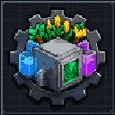

  

# IC2: Agronomy Expansion — Wiki Oficial

> **Looking for English documentation?** Check out the **[English Overview](English-Overview)** page.

O **IC2: Agronomy Expansion** (`modid: cropmanager`) é um addon de automação agrícola, genética, logística e energia sem fio para **Minecraft 1.12.2** e **IndustrialCraft 2 Experimental (`2.8.222-ex112`)**.

Ele reúne cuidado automático de cultivos IC2, monitoramento remoto com regras de parada, produção de Weed-Ex e fertilizantes, ecossistema movido a Biogás, Câmara Hidropônica fechada, armazenamento indexado de 500 sementes, multiblocos `3×5×3` de fluidos e grãos, rede Wi-Fi de EU e **15 espécies customizadas de crops IC2**.

---

## Requisitos e Instalação

| Requisito | Versão / Observação |
|---|---|
| **Minecraft** | `1.12.2` |
| **Mod Loader** | Minecraft Forge ou Cleanroom (`1.12.2`) |
| **Dependência obrigatória** | **IndustrialCraft 2 Experimental** (`ic2@[2.8.222-ex112]`) |
| **Integração opcional** | **HEI / JEI** (exibe todas as `Seed Bags` por espécie e categoria de cultivos do mod) |
| **Arquivo do Mod** | `IC2-Agronomy-Expansion-0.5.0-alpha11.jar` |
| **Resource Pack opcional** | `IC2-Agronomy-Expansion-GUI-Dark-0.5.0-alpha11.zip` (Tema Escuro `#1C1C1D`) |

### Passos de Instalação
1. Instale o **Minecraft 1.12.2** com Forge (ou Cleanroom) e **IC2 Experimental `2.8.222-ex112`**.
2. Copie **apenas** `IC2-Agronomy-Expansion-0.5.0-alpha11.jar` para a pasta `mods/` (não instale JARs `-sources` ou `-runtime-tests`).
3. Em multiplayer, cliente e servidor devem usar **exatamente a mesma versão** (`0.5.0-alpha11`).
4. *(Opcional)* O JAR principal traz a **interface clara clássica do IC2** por padrão. Para usar o tema escuro (`#1C1C1D`), copie `IC2-Agronomy-Expansion-GUI-Dark-0.5.0-alpha11.zip` (`pack_format: 3`, 20 texturas de GUI remapeadas) para `resourcepacks/` e ative-o no jogo — o mod detecta a luminosidade do painel e ajusta a cor dos textos automaticamente.

---

## Migração de Mundos Antigos

> Faça backup do seu mundo antes de atualizar versões alpha.

- **Crop Manager básico → Crop Manager Avançado:** blocos antigos `crop_manager` migram automaticamente após o carregamento do chunk (até 32 migrações por tick via `LegacyMigration`), preservando inventário, EU, tanques, área e controles.
- **Blocos e itens legados removidos:** blocos descontinuados (`agricultural_collector`, `agricultural_reservoir` antigo, `seed_classifier`, `seed_workbench`) devolvem seus itens ao chão via `LegacyRecoveryTile`. Itens antigos em inventários são remapeados automaticamente via Forge `MissingMappings` (ex.: `agricultural_notebook` / `reservoir_guide` → `Manual Agrícola`).
- O **Crop-Matron** e o **Crop Harvester** nativos do IC2 continuam disponíveis normalmente.

---

## Trilha de Progressão Recomendada

1. **Início sem EU:** Monte uma **Composteira Manual** (`manual_composter`) para produzir **Composto Orgânico** (`organic_compost`), crie o **Manual Agrícola** (`agricultural_manual`) e hidrate seus primeiros cultivos com o **Regador Agrícola Mk1** (`sprinkler_mk1`) sobre uma fonte de água.
2. **Genética e Polinização:** Use a **Sonda Agrícola** (`agricultural_probe`), o **Analisador de Sementes** (`seed_analyzer`), a **Ferramenta de Cruzamento** (`crossing_tool`) e a **Colmeia Polinizadora** (`pollinator_hive`) com **Pó Mutagênico** (`mutagenic_powder`) para cruzar e indexar sementes no **Baú de Dados de Cultivos** (`crop_database_chest`).
3. **Química e Biogás:** Automatize fertilizante na **Composteira Elétrica** (`electric_composter`), produza Weed-Ex na linha **Moedor de Grin → Extrator de Grin → Misturador de Weed-Ex** e elimine ervas sem gastar EU com o **Capinador a Biogás** (`biogas_weeder`) e o **Pulverizador a Biogás** (`biogas_sprayer`).
4. **Automação Tier 2 e Telemetria:** Instale o **Crop Manager Avançado** (`advanced_crop_manager`) vinculado ao **Monitor Agrícola** (`agricultural_monitor`) para cuidar de até `17×17×3` com regras automáticas de parada e transferência sem fio de colheitas.
5. **Endgame Agrícola:** Cultive em ambiente fechado na **Câmara Hidropônica** (`hydroponic_chamber`) com **Vidro de Estufa** e calor (`IHeatSource`), armazene fluidos e grãos em torres multibloco `3×5×3`, distribua energia pela **Rede Wi-Fi de EU** e **Antena Parabólica**, e desbloqueie os **Crops Catalisados** (incluindo `Erva-Rádio` e `Musgo de Irídio`).

---

## Navegação da Wiki

| Página | Conteúdo |
|---|---|
| **[Automação e Monitoramento](Automacao-e-Monitoramento)** | Crop Manager Avançado, Sonda Agrícola, Monitor Agrícola, censo ambiental e regras de parada |
| **[Irrigação, Estufas e Hidroponia](Irrigacao-Estufas-e-Hidroponia)** | Regadores Mk1–Mk3, Regador Diagonal, Vidro de Estufa, Câmara Hidropônica e Luminárias |
| **[Química, Fertilizantes e Biogás](Quimica-Fertilizantes-e-Biogas)** | Composteiras, Fertilizantes, Polinização, Linha Weed-Ex, Tubo Térmico e máquinas a Biogás |
| **[Genética, Sementes e Cultivos](Genetica-Sementes-e-Cultivos)** | Analisador de Sementes, Ferramenta de Cruzamento, Baú de Dados (500 slots), Manual e as 15 Crops |
| **[Multiblocos e Logística](Multiblocos-e-Logistica)** | Reservatório Agrícola, Reservatório de Fluido Industrial, Silo Agrícola e Tubo de Fluidos |
| **[Energia Sem Fio e Upgrades](Energia-Sem-Fio-e-Upgrades)** | Upgrade Wireless EU, Rede Wi-Fi de EU (Plug/Point), Antena Parabólica e Upgrades |
| **[Receitas e Configuração](Receitas-e-Configuracao)** | Todas as receitas de crafting, chaves de `config/cropmanager.cfg`, persistência e FAQ |
| **[English Overview](English-Overview)** | Complete reference guide in English for international players |
