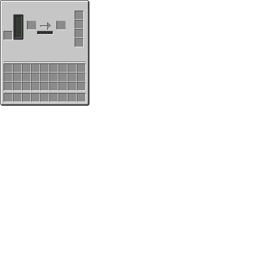
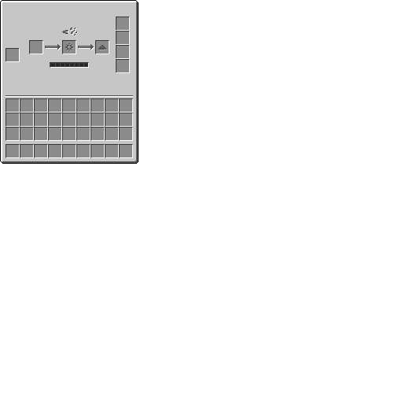
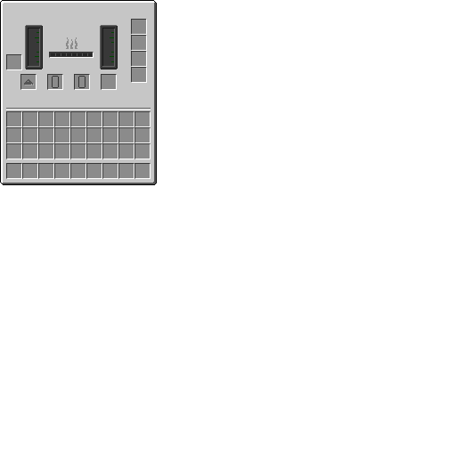
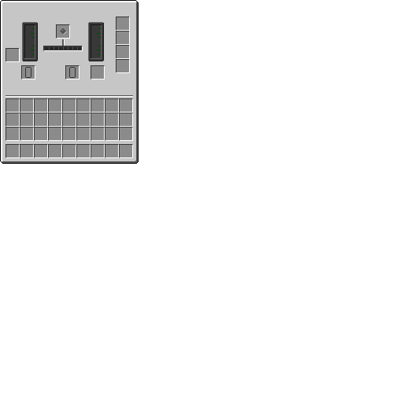
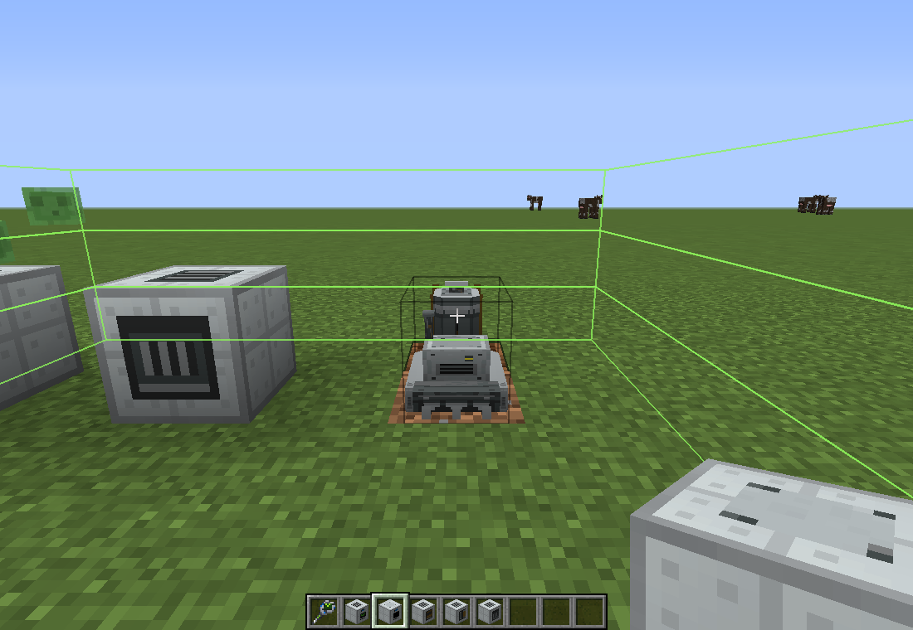

# Química, Fertilizantes e Ecossistema a Biogás

Esta página cobre a produção de fertilizantes, polinização, a cadeia completa de síntese de **Weed-Ex**, transferência térmica e as máquinas movidas a **Biogás IC2**.

---

## 1. Composteiras (Manual e Elétrica)

### Composteira Manual
*Nome em inglês: **Manual Composter** · ID: `cropmanager:manual_composter`*

Bloco de início de jogo sem consumo de EU, com 6 estados visuais dinâmicos (`fill=0..5`).
* **Interação:** clique com o botão direito segurando matéria orgânica (`Shift + Clique Direito` preenche em lote até `8` itens).
* **Conversão:** `8` itens orgânicos → `2` unidades de **Composto Orgânico** (`organic_compost`) em `1.200` ticks.
* **Hidratação:** adicione `1` balde ou frasco de água para **dobrar a velocidade (`2×`)** da fermentação.

### Composteira Elétrica
*Nome em inglês: **Electric Composter** · ID: `cropmanager:electric_composter`*

* **Especificações:** Tier 1 (`20.000 EU`), tanque de água de `16.000 mB`, 4 slots de upgrade IC2 e slot de bateria.
* **Receita:** `4` itens orgânicos + `1.000 mB` de Água → `1` **Fertilizante IC2** em `200` ticks a `5 EU/t`.
* **Insumos aceitos:** vegetais, sementes, **Bio-Fibra**, **Essência Nitro** e o item **Weed** do IC2.

---

## 2. Fertilizantes e Polinização

| Item / Bloco | ID | Efeito / Uso |
|---|---|---|
| **Composto Orgânico** (*Organic Compost*) | `cropmanager:organic_compost` | Repõe `+60` nutrientes e `+40` umidade em crops IC2 (aceito pelo Crop Manager Avançado) |
| **Fertilizante Catalítico** (*Catalytic Fertilizer*) | `cropmanager:catalytic_fertilizer` | Repõe `+100` nutrientes, concede `+40` growth points e aplica **`3` cargas de Solo Catalisado** (`cm_catalyzed`), necessárias para **Crops Catalisados** passarem do estágio 2 |
| **Pó Mutagênico** (*Mutagenic Powder*) | `cropmanager:mutagenic_powder` | Aplicado em estacas duplas vazias: adianta tentativas de cruzamento (`12` ticks), suprime ervas e concede `50%` de chance de `+1` atributo seguro. Também carrega a **Colmeia Polinizadora** |
| **Colmeia Polinizadora** (*Pollinator Hive*) | `cropmanager:pollinator_hive` | Atua em área `5×5×3` adiantando cruzamentos em estacas duplas a cada `100` ticks. Carregada com **Pó Mutagênico** (`16` cargas/pó, máximo `64`), pulsa **`3×` mais rápido** |

---

## 3. Linha de Produção de Weed-Ex

Todas as 3 máquinas abaixo são **Tier 1** (`20.000 EU`, `5 EU/t`, `100` ticks por ciclo padrão), aceitam bateria e 4 slots de upgrades IC2 (`Overclocker`, `Energy Storage`, `Transformer`, `Wireless EU`).

1. **Moedor de Grin** (*Grin Grinder* · `cropmanager:grin_grinder`):
   * Consome `1` **Olho de Aranha** usando uma **Lâmina de Moagem** (*Grinding Blade* · `cropmanager:grinding_blade`, `256` usos padrão) → gera `1` **Grin Powder** (também obtido pela crop `Erva-Grin`).
   * 
2. **Extrator de Grin** (*Grin Extractor* · `cropmanager:grin_extractor`):
   * Combina `1` **Grin Powder** + `1.000 mB` de Água → **`1.000 mB` de Extrato de Grin** (`grin_extract`).
   * 
3. **Misturador de Weed-Ex** (*Weed-Ex Mixer* · `cropmanager:weed_ex_fabricator`):
   * Combina `1.000 mB` de Extrato de Grin + `1` **Redstone** → **`500 mB` de Weed-Ex IC2** (`ic2weed_ex`).
   * 

---

## 4. Ecossistema a Biogás e Calor (`IHeatSource`)

### Capinador a Biogás
*Nome em inglês: **Biogas Weeder** · ID: `cropmanager:biogas_weeder`*

* **Zero EU:** opera exclusivamente com tanque de `16.000 mB` de **Biogás IC2**.
* **Operação:** varre `2` posições por tick (`1 mB` por posição carregada + `20 mB` por erva removida).
* **Segurança e Saída:** remove **apenas ervas daninhas reais** (`Crops.weed`) sem destruir estacas ou cultivos altos. Cada erva removida gera o item **Weed** do IC2 no slot de saída (se a saída estiver cheia, a erva permanece no Crop Stick).

### Pulverizador Agrícola a Biogás
*Nome em inglês: **Agricultural Biogas Sprayer** · ID: `cropmanager:biogas_sprayer`*

* **Zero EU:** tanques de `4.000 mB` de **Biogás IC2** + `4.000 mB` de **Água** + `1` slot de fertilizante.
* Cobre área `9×9` ao redor, hidratando (`25 mB` água + `1 mB` biogás) e adubando (`1` fertilizante + `1 mB` biogás) crops IC2 automaticamente.

### Queimador Térmico a Biogás e Tubo Térmico
* **Queimador Térmico a Biogás** (*Biogas Heat Burner* · `cropmanager:biogas_heat_burner`): consome Biogás IC2 (tanque `4.000 mB`) e fornece até **`32 HU/t`** sob demanda pela **face frontal** (`1 mB` de Biogás = `32 HU`) para máquinas adjacentes (como a **Câmara Hidropônica**) ou **Tubos Térmicos**.
* **Tubo Térmico** (*Thermal Pipe* · `cropmanager:thermal_pipe`): conecta fontes `IHeatSource` do IC2 ou do mod a máquinas que aceitam calor, conduzindo até **`100 HU/t`** (padrão). Suporta desmontagem com IC2 Wrench via `Shift + Clique Direito`.

### Gerador a Biogás Agrícola
*Nome em inglês: **Agricultural Biogas Generator** · IDs: `cropmanager:biogas_generator` + `cropmanager:biogas_generator_casing`*

* **Estrutura Multibloco `3×3×3` oca:** `25` **Carcaças do Gerador a Biogás** ao redor do núcleo vazio + `1` controlador **Gerador a Biogás Agrícola** no centro de uma parede lateral voltado para fora.
* **Geração:** tanque de `16.000 mB` de Biogás IC2 e reserva de `1.024 EU`. Emite até **`32 EU/t` (Tier 1)** pela **face frontal** (`1 mB` de Biogás = `32 EU`). Emite sinal de comparador proporcional ao nível de Biogás.
